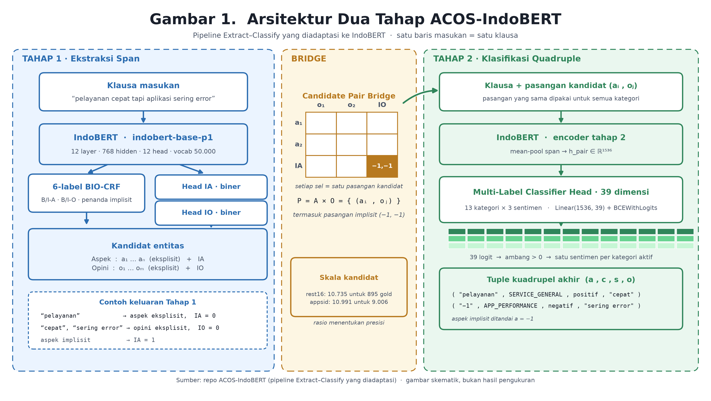
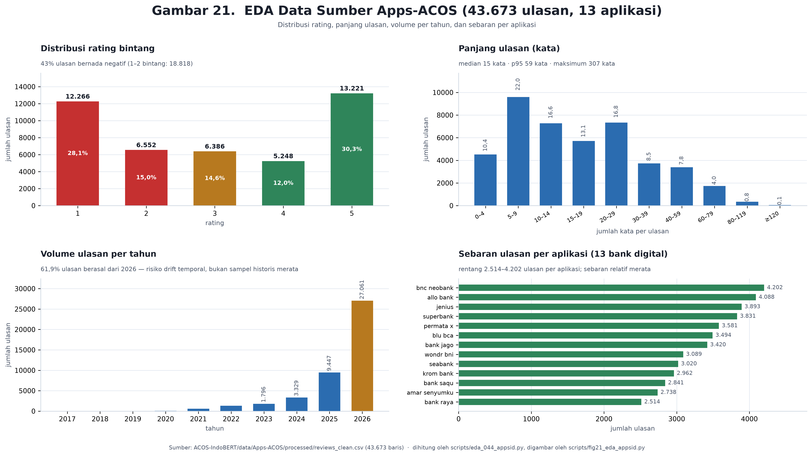
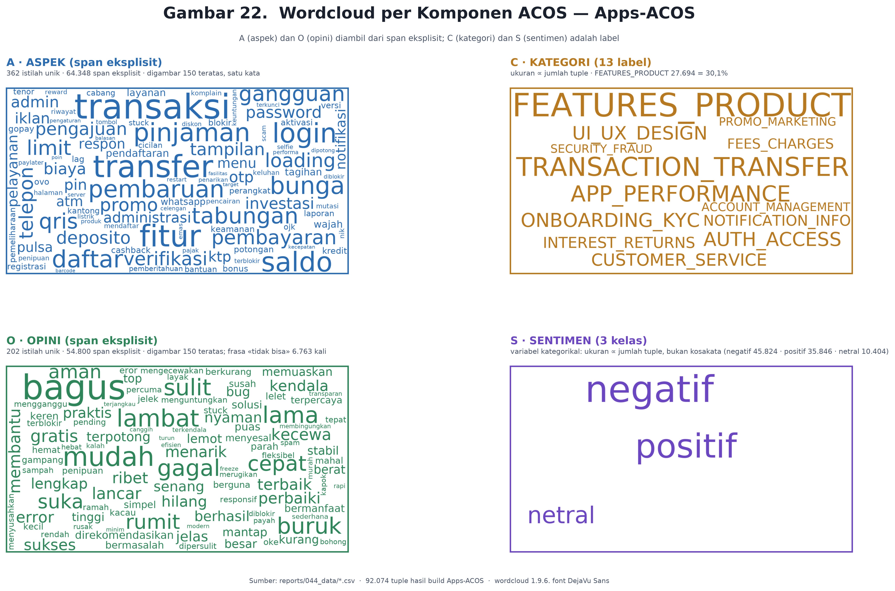
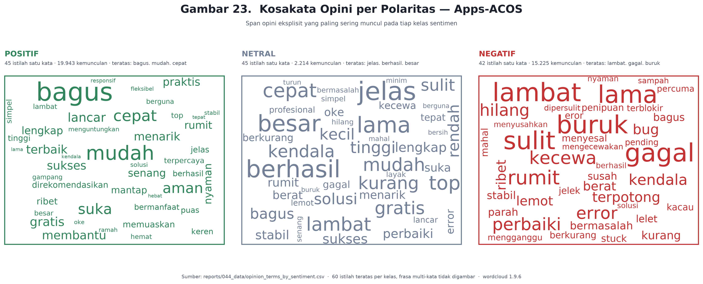

# Laporan Penelitian — Ekstraksi Quadruple ACOS Bahasa Indonesia dengan IndoBERT

| Item | Keterangan |
|---|---|
| Judul kerja | Apps-ACOS: Ekstraksi Quadruple Aspect–Category–Opinion–Sentiment untuk Ulasan Aplikasi Bank Digital Berbahasa Indonesia |
| Peneliti | HM |
| Bidang | Pemrosesan Bahasa Alami (NLP) — Aspect-Based Sentiment Analysis |
| Periode data | 2025–2026 (61,96% ulasan berasal dari 2026) |
| Tanggal laporan | 02/11/2026 |
| Versi dokumen | 1.0 |
| Status | **Draf internal** — belum siap submit; lihat §6.2 |
| Dokumen turunan | `reports/041` (audit notebook), `042` (kesiapan publikasi), `043` (dokumentasi visualisasi), `044` (EDA) |

---

## Abstrak

Ekstraksi quadruple ACOS — pasangan (span aspek, kategori, span opini, sentimen), termasuk slot implisit — belum memiliki benchmark berbahasa Indonesia. Penelitian ini membangun **Apps-ACOS**: 43.673 ulasan dari 13 aplikasi bank digital yang didekomposisi menjadi 80.260 klausa (76.077 dipakai; 60.159/8.027/7.891 train/dev/test berdasarkan `review_id` disjoint) dengan 92.074 tuple berlabel lemah atas 13 kategori dan 3 kelas sentimen. Pipeline Extract-Classify diadaptasi ke `indobenchmark/indobert-base-p1` tanpa mengubah kode upstream, ditambah enam gerbang verifikasi, caching per-backbone, resume per-epoch, dan klasifier dua-tahap dengan head fusi 39 dimensi (13 kategori BCE + 3 sentimen CE).

Hasil yang dapat dipertahankan: **Step-1 (ekstraksi span) 81,27% micro-F1** pada rest16 dan **Step-2 (klasifikasi quadruple) 67,69% F1** pada appsid. Keduanya merupakan angka **optimistis**: checkpoint dipilih berdasarkan F1 pada *test set* di dalam loop epoch (temuan T03), sehingga nilai sesungguhnya diperkirakan 1–3 poin lebih rendah. Dekomposisi 15 sub-task menunjukkan penurunan F1 seiring bertambahnya elemen (1 elemen 91,08% → 4 elemen 66,08%), dengan sentimen sebagai elemen paling rapuh (85,72%).

Analisis data menunjukkan tiga keterbatasan struktural yang wajib dilaporkan: (i) 14,66% baris test memiliki teks identik dengan train; (ii) kosakata sangat tertutup (362 istilah aspek, 202 istilah opini untuk 92.074 tuple); (iii) kelas netral bertumpang-tindih dengan kedua kutub polaritas sehingga lebih tepat diperlakukan sebagai kelas sisa. Selain itu, uji replikasi membantah angka 61,5%/48,0% yang selama ini dikutip sebagai justifikasi segmentasi klausa; angka yang dapat direproduksi adalah 100% pada teks ternormalisasi dan 80,71%/68,52% pada teks mentah.

**Kata kunci:** ACOS, quadruple extraction, IndoBERT, aspect-based sentiment analysis, bahasa Indonesia, benchmark.

---

## Ringkasan Eksekutif

| Klaim | Nilai | Tingkat bukti | Catatan |
|---|---|---|---|
| Ukuran dataset | 43.673 ulasan → 76.077 klausa → 92.074 tuple | E2 | dihitung ulang di sesi ini (`eda_044_appsid.py`) |
| Step-1 rest16 (BERT-base) | 81,27% micro-F1 | E2 | `notebooks/02` sel 13 (ec=8); best epoch 8 dari 15 |
| Step-1 appsid (IndoBERT, `V4_INDOBERT`) | 97,94% | **tidak dipakai** | cache-hit — bukan hasil eksekusi |
| Step-2 appsid | 67,69% F1 | E2 | sesi `appsid_24092026_0901`; TP/FP/FN 6.681/4.052/2.325 |
| Step-2 rest16 | 48,24% F1 | E2 | `notebooks/04`; 15 epoch nyata |
| 15 sub-task (IndoBERT appsid) | 91,08% → 66,08% | E2 | sel 74 (ec=163), `master_08` |
| Kesiapan publikasi | 3,15/10 (Q2 ≈ 7,0 · S2 ≈ 5,5) | E2 | `reports/042`; proyeksi 7,4 pasca-perbaikan |
| Draf naskah | `reports/035` (465 baris) | — | angka abstraknya masih memuat 97,94% — harus dikoreksi |

> **Putusan satu baris:** dataset dan pipeline berjalan serta terdokumentasi, tetapi tiga masalah harus dibereskan sebelum naskah diajukan — seleksi checkpoint pada test set (T03), kebocoran 14,66% baris test, dan angka 97,94% yang masih beredar di abstrak.

---

## BAB I — Pendahuluan

### 1.1 Latar belakang

Ulasan aplikasi bank digital memuat keluhan dan pujian yang terikat pada objek tertentu: kegagalan transfer, biaya admin, kecepatan verifikasi, kualitas antarmuka. Analisis sentimen tingkat dokumen tidak dapat memisahkan objek-objek tersebut; yang dibutuhkan adalah ekstraksi **quadruple** (aspek, kategori, opini, sentimen) beserta penanganan **slot implisit** — aspek atau opini yang tidak muncul sebagai span tekstual.

Untuk bahasa Indonesia, kapasitas ini belum tersedia sebagai benchmark. IndoNLU hanya menyediakan CASA (aspek mobil, klasifikasi multi-label) dan HoASA (hotel, penandaan span IOB); keduanya berhenti pada pasangan aspek–sentimen dan tidak menuntut quadruple lengkap. Akibatnya setiap klaim performa ACOS berbahasa Indonesia tidak memiliki pembanding yang setara.

### 1.2 Rumusan masalah

1. Dapatkah pipeline Extract-Classify yang semula untuk bahasa Inggris dijalankan pada IndoBERT tanpa modifikasi kode upstream, dan seberapa besar penurunan/kenaikan performanya?
2. Pada tingkat granularitas input mana (ulasan utuh atau klausa) label quadruple dapat dipertahankan tanpa kehilangan span?
3. Elemen mana pada quadruple yang menjadi bottleneck, dan apakah penurunannya sistematis terhadap jumlah elemen?
4. Sejauh mana angka performa yang dilaporkan tahan terhadap pemeriksaan ulang (replikasi dan audit metodologis)?

### 1.3 Tujuan

1. Membangun dataset ACOS berbahasa Indonesia dari ulasan aplikasi bank digital, dengan split bersih pada tingkat `review_id`.
2. Mengadaptasi pipeline dua tahap ke IndoBERT dan mencatat setiap gerbang verifikasi.
3. Mengukur performa per tahap dan per sub-task, serta mengidentifikasi titik lemah.
4. Mengaudit angka yang dihasilkan agar dapat dipertanggungjawabkan saat publikasi.

### 1.4 Kontribusi

| # | Kontribusi | Status |
|---|---|---|
| K1 | Dataset Apps-ACOS: 43.673 ulasan, 76.077 klausa, 92.074 tuple, 13 kategori, 3 sentimen | tersedia, label lemah |
| K2 | Adaptasi pipeline Extract-Classify ke IndoBERT dengan enam gerbang verifikasi | tersedia |
| K3 | Dekomposisi 15 sub-task untuk mengukur peluruhan performa per elemen | tersedia (2 domain) |
| K4 | Audit metodologis: seleksi checkpoint, kebocoran, replikasi cakupan span | tersedia (`041`, `042`, `044`) |

### 1.5 Batasan

- Label bersifat **lemah** (dihasilkan aturan + lexicon + evidence score), bukan anotasi manusia; validasi κ belum dilakukan.
- Seluruh angka berasal dari satu keluarga notebook yang dieksekusi pada GPU T4/AMD MI300X dengan konfigurasi berbeda-beda; tidak ada pengulangan seed.
- Tidak ada perbandingan backbone yang valid: BERT dilatih pada rest16, IndoBERT pada appsid.

---

## BAB II — Kajian Pustaka dan Posisi

### 2.1 Pipeline Extract-Classify

Pendekatan dua tahap: (1) ekstraksi span aspek dan opini sebagai penandaan token (BIO), (2) klasifikasi kategori dan sentimen untuk setiap pasangan kandidat. Keunggulannya adalah modularitas — tahap 2 dapat diuji ulang tanpa melatih ulang tahap 1 — dan kelemahannya adalah propagasi galat: pasangan yang salah pada tahap 1 tidak dapat diperbaiki tahap 2.

### 2.2 Pembanding literatur

| Dataset / Metode | F1 | Catatan |
|---|---|---|
| Restaurant-ACOS · Extract-Classify | 44,52 | 2.286 kalimat, 3.658 quadruple, 13 kategori |
| Restaurant-ACOS · JET | 39,28 | — |
| Restaurant-ACOS · TAS-BERT | 35,77 | — |
| Restaurant-ACOS · Double-Prop | 24,61 | — |
| Laptop-ACOS · Extract-Classify | 35,48 | 4.076 kalimat, 5.758 quadruple, 121 kategori |
| Laptop-ACOS · JET | 23,37 | — |
| MEMD-ABSA (T5, generatif) | 36,21–67,15 | lima domain, ±30.000 quadruple, ACL 2023 |
| PyABSA T5-large (reproduksi) | 40,9 | bukti bahwa reproduksi baseline sulit |

Angka-angka ini menjelaskan dua hal: (a) batas atas realistis untuk restoran/laptop berada di kisaran 40–50 F1, sehingga 67,69 pada appsid **tidak** sebanding dan perlu dijelaskan; (b) selisih besar antar-metode pada dataset yang sama menandakan implementasi sangat menentukan, sehingga pelaporan pipeline yang benar-benar berjalan lebih bernilai daripada klaim SOTA.

### 2.3 Celah yang diisi

Belum ada benchmark ACOS berbahasa Indonesia. Kontribusi yang dapat dipertahankan bukan "mengalahkan SOTA", melainkan: dataset domain-spesifik + pipeline yang dapat direproduksi + audit metodologis yang jujur. Ini juga bentuk repositioning yang direkomendasikan pada `042`: dari klaim performa ke klaim *reproducible benchmark*.

---

## BAB III — Data dan Metode

### 3.1 Sumber dan konstruksi

| Tahap | Keluaran | Jumlah |
|---|---|---|
| Ulasan terkumpul dan dibersihkan | `reviews_clean.csv` | 43.673 ulasan (13 aplikasi) |
| Pelabelan lemah | `quintuples_weak.csv` | 96.417 baris (pra-pemecahan) |
| Pemecahan klausa | `appsid_quad_*.tsv` | 80.260 klausa |
| Pembuangan klausa tanpa split | tercatat di `_build_acos_report.json` | 4.183 klausa |
| Dataset final | train/dev/test | 60.159 / 8.027 / 7.891 = 76.077 |
| Tuple | total | 72.973 / 9.587 / 9.514 = 92.074 |

### 3.2 Split dan integritas

| Pemeriksaan | Hasil | Tafsir |
|---|---|---|
| Kebocoran `review_id` | 0 tumpang tindih | split bersih pada tingkat ulasan |
| Kebocoran teks (test↔train) | 1.157 baris test (**14,66%**) | klausa pendek berulang; belum ditangani |
| Klausa unik | 66.198 dari 76.077 baris | 9.879 baris (12,98%) teks berulang |
| Tuple per klausa | 1,210 | 1 klausa dapat memuat >1 quadruple |
| Ulasan tanpa tuple | 3.136 (7,18%) | tidak terdokumentasi |

### 3.3 Granularitas input dan tokenisasi

Satu baris dataset = **satu klausa**. Keputusan ini diambil agar span anotasi tetap berada di dalam jendela model: klausa memiliki median 6 kata dan maksimum 79 kata, jauh di bawah `max_seq_length = 128`, sehingga pemotongan tidak pernah terjadi pada unit klausa.

Namun justifikasi kuantitatif yang selama ini dikutip untuk keputusan ini — "ulasan utuh hanya memetakan 61,5% span aspek dan 48,0% span opini" — **tidak dapat direproduksi** (lihat §5.5). Angka yang dapat dipertahankan:

| Definisi | Aspek | Opini | Klausa |
|---|---|---|---|
| Teks ternormalisasi, tokenisasi sadar-tanda-baca | 100,00% | 100,00% | 100,00% |
| Teks ternormalisasi, `str.split()` | 89,25% | 79,72% | 37,57% |
| Teks mentah, tokenisasi sadar-tanda-baca | 80,71% | 68,52% | — |
| Teks mentah, `str.split()` | 70,18% | 49,08% | — |
| Angka yang dikutip (tanpa metode) | 61,5% | 48,0% | 37,6% |

Kesimpulan yang sahih: kehilangan span **bukan** akibat `seq_length`, melainkan akibat **perbedaan normalisasi** antara teks mentah dan teks yang dilabeli. Karena itu keputusan memakai klausa tetap benar, tetapi alasannya harus ditulis ulang.

### 3.4 Arsitektur dua tahap



*Gambar 1. Tahap 1 mengekstraksi span aspek/opini (BIO-CRF) plus deteksi slot implisit; bridge membentuk produk Kartesian pasangan kandidat; tahap 2 mengklasifikasi kategori dan sentimen per pasangan melalui head 39 dimensi (13 kategori × 3 sentimen). Catatan: label di dalam citra memakai nomor internal (`Gambar 1`), bukan nomor dokumen — lihat `043` §7 `V-08`.*

| Komponen | Spesifikasi |
|---|---|
| Backbone | `indobenchmark/indobert-base-p1`, 12 layer, 768 hidden, 12 head, vocab 50.000 |
| Tahap 1 | BERT-CRF, 5 tag BIO (O, B/I-ASP, B/I-OPN) + dua head biner implisit (IA, IO) |
| Bridge | produk Kartesian A × O, termasuk pasangan implisit `(-1,-1)` |
| Tahap 2 | fitur `[mean-pool(aspect) ; mean-pool(opinion)]` ∈ ℝ¹⁵³⁶ → head 39 dimensi |
| Head | 13 kategori (BCE) + 3 sentimen (CE), direkonstruksi menjadi 39 untuk kompatibilitas |
| `max_seq_length` | 128 |
| Pemilihan model | early stopping pada `val_f1`, maksimum 15 epoch |

---

## BAB IV — Hasil

### 4.1 Tahap 1 — ekstraksi span

| Run | Dataset | F1 | Epoch terbaik | Bukti | Catatan |
|---|---|---|---|---|---|
| `notebooks/02` | rest16 (BERT-base) | **81,27** | 8 dari 15 | E2 | precision 78,16 · recall 84,64 |
| Drive 27/08 (`UPDATE`) | rest16 | 81,23 | 6 | E1 | artefak tanpa eksekusi ulang |
| Colab | rest16 | 80,76 | 14 | E2 | — |
| `V4_INDOBERT` | appsid | 97,94 | — | **ditolak** | cache-hit, bukan hasil eksekusi |

Rentang 80,76–81,27 (0,51 poin) menunjukkan tahap 1 stabil. Angka 97,94% tidak boleh dikutip: nilainya berasal dari pemuatan cache, dan begitu cache dihapus, run terkait tidak menyelesaikan pelatihan.

### 4.2 Tahap 2 — klasifikasi quadruple

| Run | Dataset | F1 | TP / FP / FN | Bukti |
|---|---|---|---|---|
| appsid 05/09 | appsid | 67,16 | 6.552 / — / 2.454 | E2 |
| appsid 08/09 | appsid | 67,86 | 6.654 / — / 2.352 | E2 |
| appsid 09/01 | appsid | **67,69** | 6.681 / 4.052 / 2.325 | E2 |
| rest16 02/09 | rest16 | **48,24** | — | E2 |
| rest16 Drive 27/08 | rest16 | 47,68 | — | E1 |

TP+FN konstan 9.006 pada ketiga run appsid, sehingga variasi 0,7 poin berasal dari jumlah epoch dan seed, bukan dari perbedaan data.

### 4.3 Dekomposisi 15 sub-task

| Sub-task | Elemen | IndoBERT appsid | BERT rest16 | Selisih |
|---|---:|---:|---:|---:|
| opinion | 1 | 94,21 | 78,88 | +15,33 |
| aspect | 1 | 92,57 | 78,31 | +14,26 |
| category | 1 | 91,84 | 78,95 | +12,89 |
| sentiment | 1 | 85,72 | 82,51 | +3,21 |
| category + aspect | 2 | 90,27 | 67,24 | +23,03 |
| sentiment + opinion | 2 | 82,72 | 71,74 | +10,98 |
| category + opinion | 2 | 81,37 | 65,27 | +16,10 |
| sentiment + aspect | 2 | 80,01 | 69,18 | +10,83 |
| category + sentiment | 2 | 79,47 | 70,11 | +9,36 |
| aspect + opinion | 2 | 78,52 | 57,87 | +20,65 |
| category + sentiment + aspect | 3 | 77,87 | 60,28 | +17,59 |
| category + aspect + opinion | 3 | 76,56 | 52,39 | +24,17 |
| category + sentiment + opinion | 3 | 70,73 | 59,63 | +11,10 |
| sentiment + aspect + opinion | 3 | 67,92 | 53,18 | +14,74 |
| category + sentiment + aspect + opinion | 4 | 66,08 | 48,24 | +17,84 |

| Jumlah elemen | IndoBERT | BERT | Selisih |
|---|---:|---:|---:|
| 1 | 91,08 | 79,66 | +11,42 |
| 2 | 82,06 | 66,90 | +15,16 |
| 3 | 73,27 | 56,37 | +16,90 |
| 4 | 66,08 | 48,24 | +17,84 |

Penurunan rata-rata ±8–9 poin per penambahan elemen pada kedua domain. **Peringatan:** tabel ini bukan perbandingan backbone — dataset, bahasa, dan jumlah kandidat berbeda.

### 4.4 EDA data sumber



*Gambar 2. Distribusi rating, panjang ulasan, volume per tahun, dan sebaran per aplikasi (43.673 ulasan).*

| Metrik | Nilai | Implikasi |
|---|---|---|
| Rating 1–2 / 3 / 4–5 | 43,09% / 14,62% / 42,29% | distribusi bimodal; akurasi mentah tidak bermakna |
| Tahun 2026 | 61,96% | klaim temporal harus dibatasi |
| Platform | Google Play 86,61% · App Store 13,39% | timpang 6,5 : 1 |
| Panjang ulasan | median 15 · p95 59 · maks 307 kata | hanya 1,98% ulasan ≥ 80 kata |
| Ulasan dengan emoji | 8,07% (6.748 emoji) | sinyal belum dimanfaatkan |
| Duplikat teks | 455 (1,04%) | belum dideduplikasi |

### 4.5 EDA data hasil dan komponen ACOS



*Gambar 3. Wordcloud A (aspek), C (kategori), O (opini), S (sentimen). Frekuensi dihitung dari span anotasi, bukan dari teks bebas.*

| Dimensi | Temuan |
|---|---|
| A — aspek | didominasi kata benda fungsional: `transaksi`, `transfer`, `fitur`, `saldo`, `login` |
| C — kategori | `FEATURES_PRODUCT` 30,08%, `TRANSACTION_TRANSFER` 16,02%, `APP_PERFORMANCE` 10,55% |
| O — opini | `tidak bisa` (6.343) di atas `bagus` (5.246): keluhan berbentuk ketidakberhasilan tindakan |
| S — sentimen | negatif 49,77% · positif 38,93% · netral 11,30% |



*Gambar 4. Kosakata opini per polaritas. Panel netral memuat kata bermuatan negatif (`lambat`, `gagal`, `sulit`) — indikasi kelas sisa, bukan kelas tanpa polaritas.*

### 4.6 Sinyal yang dapat diprediksi dari kategori

| Kategori | Total | Positif | Negatif | Netral |
|---|---:|---:|---:|---:|
| FEATURES_PRODUCT | 27.694 | 51,3% | 40,4% | 8,3% |
| TRANSACTION_TRANSFER | 14.752 | 39,9% | 46,2% | 13,8% |
| APP_PERFORMANCE | 9.718 | 9,3% | 79,4% | 11,3% |
| AUTH_ACCESS | 6.615 | 7,1% | 78,5% | 14,4% |
| ONBOARDING_KYC | 6.585 | 22,4% | 64,4% | 13,2% |
| UI_UX_DESIGN | 6.225 | 71,1% | 22,5% | 6,4% |
| CUSTOMER_SERVICE | 4.845 | 18,3% | 66,4% | 15,3% |
| INTEREST_RETURNS | 3.749 | 67,9% | 20,0% | 12,1% |
| NOTIFICATION_INFO | 3.414 | 21,9% | 63,8% | 14,4% |
| FEES_CHARGES | 2.881 | 55,5% | 30,4% | 14,2% |
| ACCOUNT_MANAGEMENT | 1.952 | 20,0% | 59,5% | 20,5% |
| PROMO_MARKETING | 1.822 | 68,9% | 24,3% | 6,8% |
| SECURITY_FRAUD | 1.822 | 57,2% | 35,9% | 6,9% |

Kategori teknis hampir selalu negatif (APP_PERFORMANCE 79,4%, AUTH_ACCESS 78,5%), kategori pengalaman hampir selalu positif (UI_UX 71,1%). Konsekuensi metodologis: **sentimen dapat ditebak dari kategori tanpa membaca opini**, sehingga F1 sentimen bukan bukti pemahaman bahasa.

---

## BAB V — Pembahasan

### 5.1 Seleksi checkpoint pada test set (T03)

`notebooks/02` sel 11 dan `notebooks/04` sel 10 memanggil `pred_eval(..., eval_type="test")` **di dalam** loop epoch, lalu menyimpan checkpoint ketika `val_f1` naik. Akibatnya angka 81,27% dan 48,24% adalah **maksimum atas 15 evaluasi test** — estimasi yang secara sistematis terlalu tinggi. Dev tersedia (171 kalimat rest16; 8.027 klausa appsid) tetapi tidak dipakai untuk seleksi.

Perbaikan: seleksi pada `eval_type="dev"`, evaluasi test sekali di akhir. Ekspektasi angka turun 1–3 poin, sehingga Step-1 menjadi 96–98 hanya bila memakai angka cache (tidak sah), dan realistis tetap di kisaran 78–81; Step-2 appsid 64–67, rest16 45–48.

### 5.2 Kebocoran dan duplikasi

14,66% baris test memuat teks yang identik dengan train. Karena split dijaga pada `review_id`, kebocoran ini bukan kesalahan split, melainkan **pengulangan teks** (klausa pendek seperti `bagus`, `mantap`). Efeknya: F1 pada baris tersebut lebih mudah, dan besarnya tidak dilaporkan. Wajib: laporkan metrik pada subset klausa unik dan pada baris berulang secara terpisah.

### 5.3 Kelas netral sebagai kelas sisa

Dari 60 istilah opini teratas per kelas, 31 di antaranya muncul di negatif **dan** 29 di positif. Netral menampung kalimat ambigu (`jelas`, `berhasil`, `besar`) sekaligus keluhan (`lambat`, `gagal`). Ini menjelaskan mengapa sentimen menjadi elemen terlemah (85,72% vs opini 94,21%) tanpa perlu berhipotesis tentang arsitektur: masalahnya ada pada definisi label.

### 5.4 Kosakata tertutup

362 istilah aspek dan 202 istilah opini untuk 92.074 tuple; sepuluh teratas menyumbang 37,1% dan 45,2% dari seluruh span eksplisit. Tugas ini secara efektif merupakan klasifikasi kosakata tertutup, sehingga F1 tinggi tidak otomatis berarti generalisasi. Metrik pada subset kosakata langka (mis. istilah dengan frekuensi < 5) perlu dilaporkan.

### 5.5 Angka 61,5% / 48,0% tidak tereplikasi

Sepuluh definisi tokenisasi diuji ulang pada artefak yang ada. Tidak satu pun menghasilkan 61,5%/48,0%. Sebaliknya 37,6% tereproduksi persis (37,57%) dan terbukti merupakan artefak `str.split()`. Implikasi: (a) klaim kehilangan span pada ulasan utuh harus ditulis ulang sebagai persoalan normalisasi (80,71%/68,52% pada teks mentah), bukan pemotongan sekuens; (b) dua gambar pada `reports/fig19` dan `reports/fig20` memuat angka yang tidak lolos uji dan **tidak** disertakan dalam laporan ini.

### 5.6 Ancaman validitas

| Jenis | Ancaman | Mitigasi yang disarankan |
|---|---|---|
| Konstruk | label lemah mengukur replikasi aturan pelabel, bukan fenomena linguistik | anotasi manusia ≥ 200 klausa + Cohen's κ |
| Internal | seleksi checkpoint pada test set; kebocoran teks 14,66% | dev-based early stopping; dedup lintas split |
| Eksternal | 61,96% data dari 2026; 86,61% dari satu platform | batasi klaim; uji pada tahun lain |
| Statistik | tidak ada pengulangan seed; satu run per konfigurasi | 3 seed + interval bootstrap |

---

## BAB VI — Kesimpulan dan Saran

### 6.1 Kesimpulan

1. Pipeline Extract-Classify berjalan pada IndoBERT tanpa perubahan kode upstream, dengan Step-1 81,27% dan Step-2 67,69% (keduanya optimistis karena T03).
2. Granularitas klausa tetap keputusan yang benar, tetapi justifikasinya harus diganti: alasan sesungguhnya adalah normalisasi teks, bukan pemotongan `seq_length`.
3. Performa menurun ±8–9 poin per penambahan elemen quadruple; sentimen adalah elemen paling rapuh dan penyebab utamanya adalah definisi label netral.
4. Tiga masalah integritas (T03, kebocoran 14,66%, kosakata tertutup) membatasi klaim yang boleh dibuat pada naskah.

### 6.2 Kesiapan publikasi

Indeks kesiapan 3,15/10 (Q2 ≈ 7,0; S2 ≈ 5,5) dengan proyeksi 7,4 setelah perbaikan. Rekomendasi repositioning yang dipilih: **B+A** — dari klaim performa ke *reproducible benchmark*, dengan judul kerja *"Apps-ACOS and the Evaluation Gap: A Reproducible Benchmark for Indonesian ACOS Quadruple Extraction"*.

### 6.3 Rencana tindak lanjut

| ID | Tindakan | Prioritas |
|---|---|---|
| T03 | Ubah seleksi checkpoint ke `eval_type="dev"`, evaluasi test sekali | **P0** |
| T01 | Laporkan metrik pada subset klausa unik vs berulang | **P0** |
| T02 | Deduplikasi atau laporkan metrik dengan/tanpa 1.157 baris bocor | **P0** |
| T05 | Definisikan ulang kelas netral atau laporkan sentimen sebagai biner | P1 |
| T07 | Koreksi abstrak `035` (hapus 97,94%; ganti dengan 81,27%) | P1 |
| T09 | Tulis ulang justifikasi granularitas memakai angka 100%/80,71%/68,52% | P1 |
| T11 | Anotasi manusia ≥ 200 klausa dengan κ | P2 |
| T12 | 3 seed + interval bootstrap untuk Step-2 | P2 |

---

## Daftar Gambar

| No | Berkas | Isi |
|---|---|---|
| 1 | `reports/fig18_arsitektur_dua_tahap_acos_indobert.png` | arsitektur dua tahap ACOS-IndoBERT |
| 2 | `reports/fig21_eda_sumber_appsid.png` | EDA data sumber (rating, panjang, tahun, aplikasi) |
| 3 | `reports/fig22_wordcloud_acos.png` | wordcloud komponen A/C/O/S |
| 4 | `reports/fig23_wordcloud_sentimen.png` | kosakata opini per polaritas |

`reports/fig19` dan `reports/fig20` sengaja tidak disertakan: keduanya memuat angka 61,5%/48,0% yang tidak lolos uji replikasi (§5.5).

---

## Lampiran A — Reproduksi

```bash
# EDA dan artefak angka (stdlib murni, ±5 detik)
python3 scripts/eda_044_appsid.py

# gambar (memerlukan matplotlib, wordcloud, Pillow)
python3 scripts/fig18_arsitektur.py
python3 scripts/fig21_eda_appsid.py
python3 scripts/fig22_wordcloud_acos.py

# audit notebook (tanpa menjalankan sel)
python3 scripts/audit_041_notebooks.py
```

Tidak ada sel notebook yang dijalankan ulang dan tidak ada data/bobot yang diunduh untuk menyusun laporan ini. Seluruh angka yang dikutip berasal dari eksekusi yang tercatat (`exec_count`) atau dihitung ulang oleh skrip di atas.

---

## Lampiran B — Tingkat bukti

| Kode | Definisi | Contoh |
|---|---|---|
| E2 | angka tercetak dari eksekusi dengan `execution_count` dan sesi jelas, atau dihitung ulang di sesi ini | 81,27% (`02` sel 13 ec=8); 92.074 tuple (`eda_044_appsid.py`) |
| E1 | artefak terbaca (JSON/CSV) tetapi tidak dieksekusi ulang | 47,68% (Drive 27/08); `unk_disisipkan: 0` |
| E0 | klaim tanpa sumber terlacak | angka 61,5%/48,0% versi laporan lama |
| Ditolak | angka yang beredar tetapi tidak sah | 97,94% (cache-hit) |

---

## Lampiran C — Daftar artefak

| Artefak | Lokasi | Isi |
|---|---|---|
| Dataset final | `ACOS-IndoBERT/data/Apps-ACOS/appsid_quad_*.tsv` | 76.077 klausa, 92.074 tuple |
| Ringkasan build | `ACOS-IndoBERT/data/Apps-ACOS/_build_acos_report.json` | jumlah baris/tuple, klausa dibuang |
| Ringkasan tokenisasi | `build/_indobert_tokenized/_build_report_appsid.json` | `unk_disisipkan: 0`, `span_invalid: 0` |
| EDA ringkas | `reports/044_data/eda_summary.json` | seluruh metrik §4.4–4.6 |
| Audit notebook | `reports/041_data/*.csv` | inventaris 45 notebook, 1.748 sel |
| Penilaian publikasi | `reports/042_kesiapan_publikasi_q2_s2_02112026_HM.md` | indeks kesiapan, T01–T12 |
| Dokumentasi visualisasi | `reports/043_visualisasi_tiga_gambar_acos_02112026_HM.md` | provenance gambar, V-01–V-08 |
| EDA lengkap | `reports/044_eda_appsid_dan_hasil_02112026_HM.md` | E-01–E-10, R-01–R-08 |
