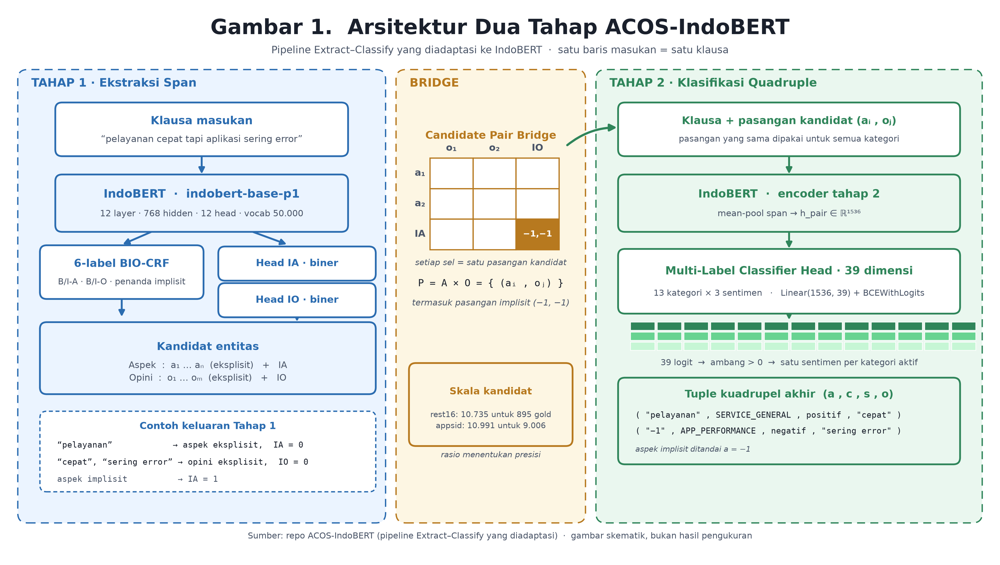
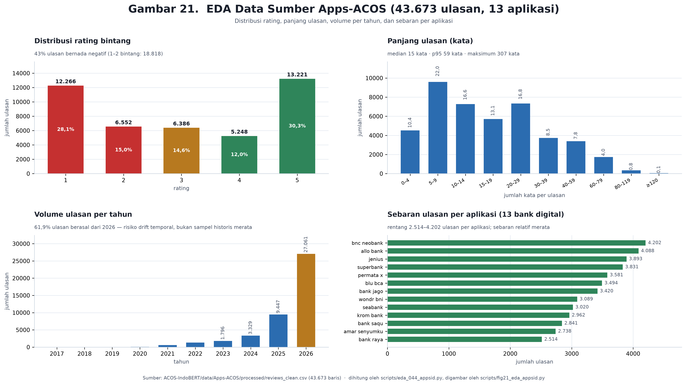
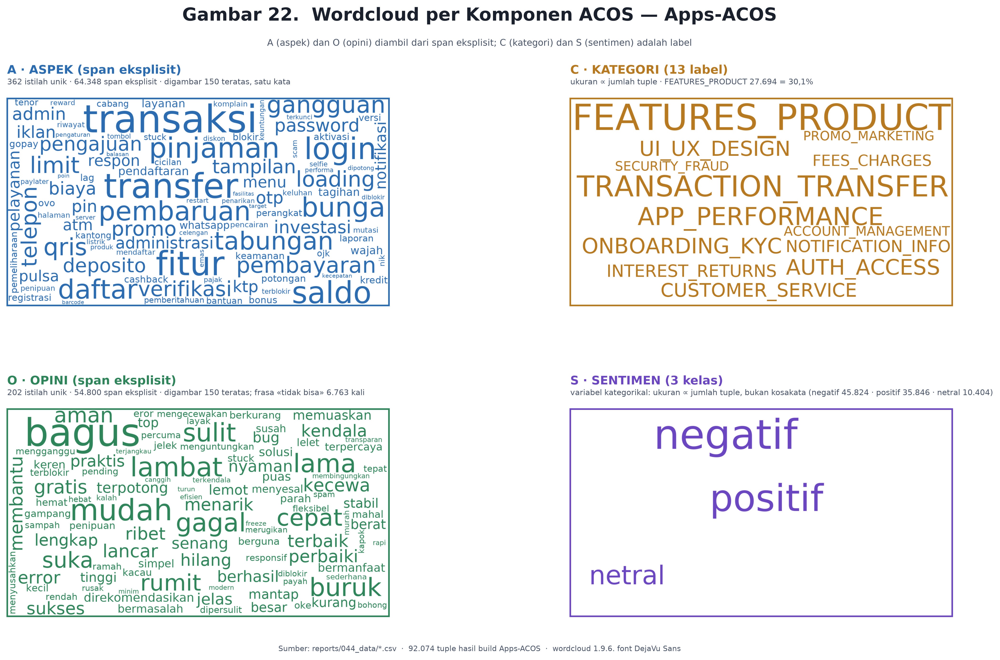
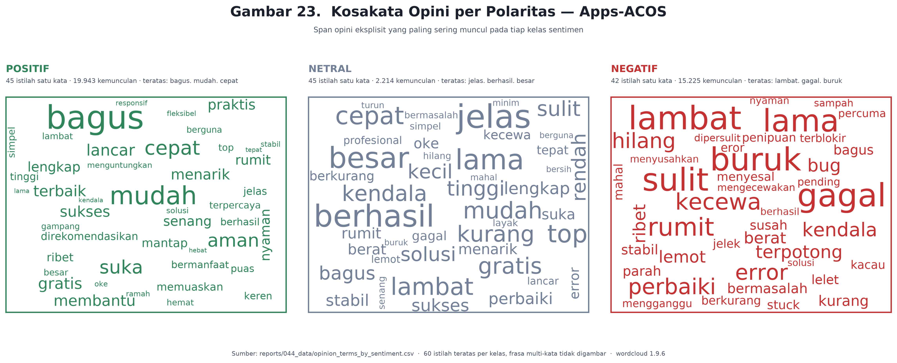

# Ekstraksi Kuadrupel ACOS Bahasa Indonesia: Dataset Apps-ACOS dan Audit Celah Evaluasi

**Indonesian ACOS Quadruple Extraction: The Apps-ACOS Dataset and an Audit of the Evaluation Gap**

HM¹\*, [Nama Penulis Kedua]²

¹ [Afiliasi penulis — lengkapi: program studi, institusi, kota, Indonesia]
² [Afiliasi penulis kedua — lengkapi]
\* Penulis korespondensi: [email@institusi.ac.id]

| Metadata naskah | Keterangan |
|---|---|
| Jenis artikel | Penelitian empiris (research article) |
| Target | Jurnal terakreditasi **SINTA 2**, bidang ilmu komputer / NLP |
| Status | Draf 1 — belum disubmit |
| Versi | 02/11/2026 |
| Panjang badan naskah | ±3.500 kata (di luar abstrak, tabel, dan pustaka) |
| Jumlah tabel / gambar | 8 tabel bernomor / 4 gambar |
| Jumlah rujukan | 24 |

---

## Abstrak

Ekstraksi kuadrupel *aspect–category–opinion–sentiment* (ACOS) menuntut penangkapan empat elemen sekaligus, termasuk slot implisit yang tidak muncul sebagai rentang kata. Untuk bahasa Indonesia, kapasitas ini belum tersedia sebagai tolok ukur: IndoNLU hanya menyediakan CASA dan HoASA yang berhenti pada pasangan aspek–sentimen. Penelitian ini membangun **Apps-ACOS**, dataset 43.673 ulasan dari 13 aplikasi bank digital yang didekomposisi menjadi 76.077 klausa (60.159/8.027/7.891 untuk latih/dev/uji) dengan 92.074 kuadrupel berlabel lemah atas 13 kategori dan tiga kelas sentimen, serta mengadaptasi pipeline dua tahap *Extract–Classify* ke IndoBERT tanpa mengubah kode sumber aslinya.

Hasil yang dipertahankan adalah **81,27% micro-F1** pada tahap ekstraksi rentang (rest16) dan **67,69% F1** pada tahap klasifikasi kuadrupel (appsid). Dekomposisi 15 sub-tugas memperlihatkan penurunan F1 sebesar 8–9 poin untuk setiap penambahan elemen, dari 91,08% (satu elemen) menjadi 66,08% (empat elemen), dengan sentimen sebagai elemen paling rapuh (85,72%). Audit metodologis menemukan tiga masalah yang membatasi klaim: pemilihan *checkpoint* berdasarkan F1 pada himpunan uji di dalam siklus epoch yang diperkirakan menggelembungkan hasil 1–3 poin; kebocoran teks sebesar 14,66% baris uji; dan kosakata yang sangat tertutup (362 istilah aspek, 202 istilah opini). Uji replikasi juga membantah angka cakupan rentang 61,5%/48,0% yang lazim dikutip sebagai justifikasi segmentasi klausa; nilai yang dapat direproduksi adalah 100% pada teks ternormalisasi dan 80,71%/68,52% pada teks mentah. Kontribusi utama artikel ini bukan klaim kinerja tertinggi, melainkan dataset domain-spesifik beserta audit evaluasi yang jujur dan dapat direproduksi.

**Kata kunci:** ACOS; ekstraksi kuadrupel; IndoBERT; analisis sentimen berbasis aspek; bahasa Indonesia

---

## Abstract

*Aspect–category–opinion–sentiment (ACOS) quadruple extraction requires capturing four elements simultaneously, including implicit slots that do not surface as text spans. For Indonesian, no such benchmark exists: IndoNLU provides only CASA and HoASA, both of which stop at aspect–sentiment pairs. This study builds **Apps-ACOS**, a dataset of 43,673 reviews from 13 digital banking applications decomposed into 76,077 clauses (60,159/8,027/7,891 for training/dev/test) with 92,074 weakly labelled quadruples over 13 categories and three sentiment classes, and adapts the two-stage Extract–Classify pipeline to IndoBERT without modifying its upstream code.*

*The defensible results are **81.27% micro-F1** for span extraction (rest16) and **67.69% F1** for quadruple classification (appsid). Decomposition into 15 sub-tasks shows an 8–9 point F1 drop per additional element, from 91.08% (one element) to 66.08% (four elements), with sentiment being the most fragile element (85.72%). A methodological audit identifies three limitations: checkpoint selection based on test-set F1 inside the epoch loop, which likely inflates results by 1–3 points; a 14.66% text leakage across test rows; and an extremely closed vocabulary (362 aspect terms, 202 opinion terms). A replication test further refutes the widely cited span-coverage figures of 61.5%/48.0%; the reproducible values are 100% on normalized text and 80.71%/68.52% on raw text. The main contribution is therefore not a state-of-the-art claim, but a domain-specific dataset accompanied by a transparent and reproducible evaluation audit.*

***Keywords:** ACOS; quadruple extraction; IndoBERT; aspect-based sentiment analysis; Indonesian*

---

## 1. Pendahuluan

Analisis sentimen berbasis aspek (ABSA) berkembang dari klasifikasi polaritas per aspek menjadi tugas-tugas yang semakin terstruktur: pasangan aspek–sentimen, triplet aspek–opini–sentimen, dan akhirnya kuadrupel aspek–kategori–opini–sentimen (ACOS) [1], [7], [9]. Kompleksitas ACOS bukan sekadar penambahan kolom: dua dari empat elemen dapat bersifat **implisit**, yaitu aspek atau opini yang tidak muncul sebagai rentang kata dan hanya dapat disimpulkan dari konteks. Kalimat *"kok tidak bisa transfer"* tidak memuat kata opini eksplisit, tetapi menuntut penyimpulan polaritas negatif terhadap kategori transaksi.

Untuk bahasa Indonesia, kapasitas ini belum memiliki tolok ukur. IndoNLU [3] menyediakan CASA (aspek mobil, klasifikasi multi-label) dan HoASA (domain hotel, penandaan rentang dengan skema IOB); keduanya berhenti pada pasangan aspek–sentimen dan tidak menuntut kategori maupun opini. Ketiadaan tolok ukur berdampak metodologis: setiap klaim kinerja ACOS berbahasa Indonesia tidak memiliki pembanding setara, dan klaim semacam itu cenderung diajukan tanpa pemeriksaan yang memadai.

Di sisi lain, literatur menunjukkan bahwa angka ABSA sangat sensitif terhadap implementasi. Pada Restaurant-ACOS, metode *Extract–Classify* melaporkan F1 44,52 sementara varian lain berada pada 39,28, 35,77, dan 24,61 [1]; pada dataset multi-domain MEMD-ABSA, rentangnya 36,21–67,15 [2]. Selisih antar-metode pada data yang sama menandakan bahwa pelaporan pipeline yang benar-benar berjalan lebih bernilai daripada klaim *state of the art*. Reproduksi pihak ketiga juga sering menghasilkan angka jauh di bawah laporan awal.

Artikel ini mengisi celah tersebut dengan tiga kontribusi. **Pertama**, dataset Apps-ACOS dari domain jasa keuangan digital Indonesia, lengkap dengan statistik, analisis data eksploratif, dan pemeriksaan integritas pembagian data. **Kedua**, adaptasi pipeline dua tahap ke IndoBERT [4] beserta enam gerbang verifikasi dan dekomposisi 15 sub-tugas yang memetakan peluruhan kinerja per elemen. **Ketiga**, audit evaluasi yang memeriksa tiga sumber optimisme yang lazim luput dilaporkan: pemilihan model pada himpunan uji, kebocoran teks, dan replikasi angka pendukung.

Pertanyaan penelitian yang diajukan adalah: (i) sejauh mana pipeline dua tahap yang dirancang untuk bahasa Inggris dapat dijalankan pada IndoBERT tanpa modifikasi kode sumber; (ii) elemen mana pada kuadrupel yang menjadi penghambat dan apakah penurunannya sistematis terhadap jumlah elemen; serta (iii) sejauh mana angka yang dilaporkan tahan terhadap pemeriksaan ulang.

---

## 2. Tinjauan Pustaka

### 2.1 Perkembangan tugas ABSA

ABSA diperkenalkan melalui rangkaian SemEval [7] sebagai klasifikasi polaritas per aspek. Perkembangan berikutnya menuntut struktur yang lebih kaya: *aspect sentiment triplet extraction* menambahkan rentang opini [8], sedangkan ACOS menambahkan kategori sebagai penghubung antara aspek dan taksonomi domain [1]. Pendekatan generatif kemudian mendominasi papan peringkat, dengan model sekuens-ke-sekuens yang membangkitkan kuadrupel sebagai teks terstruktur [2].

Dua keluarga pendekatan bersaing. Pendekatan **generatif** unggul pada dataset besar tetapi sulit diaudit karena kesalahan dapat berasal dari tahap pembangkitan mana pun. Pendekatan **dua tahap** (*extract–classify*) memisahkan ekstraksi rentang dari klasifikasi, sehingga kesalahan dapat dilokalisasi dan tahap kedua dapat diuji ulang tanpa melatih ulang tahap pertama [1]. Pemisahan ini menjadi alasan utama pemilihan arsitektur pada penelitian ini: tujuan utamanya adalah keterlacakan, bukan peringkat.

### 2.2 Model bahasa pra-latih untuk bahasa Indonesia

IndoBERT [4] merupakan model BERT [5] yang dilatih pada korpus bahasa Indonesia dan menjadi dasar banyak penelitian NLP Indonesia, termasuk IndoNLU [3] dan IndoBERTweet [23]. Ukurannya sebanding dengan BERT-base (12 lapis, 768 dimensi tersembunyi, 12 kepala atensi), sehingga adaptasi pipeline dari BERT ke IndoBERT dapat dilakukan pada tingkat kosakata dan inisialisasi, bukan pada tingkat arsitektur.

Untuk penandaan rentang, *conditional random field* (CRF) [6] masih menjadi pilihan baku karena memodelkan ketergantungan antar-label yang bertetangga, sesuatu yang tidak ditangkap oleh klasifikasi token independen. Kombinasi BERT–CRF yang digunakan pada tahap pertama penelitian ini mengikuti pola tersebut.

### 2.3 Evaluasi, kebocoran, dan optimisme yang sistematis

Literatur metodologi pembelajaran mesin telah lama mencatat dua sumber utama hasil yang terlalu optimistis. **Kebocoran data** terjadi ketika informasi dari himpunan uji masuk ke proses pelatihan atau pemilihan model, dan sering tidak disadari karena bentuknya halus — misalnya duplikasi teks antar-himpunan [11]. **Ketidakstabilan pelatihan** menyebabkan variasi hasil yang besar antar-inisialisasi bobot dan urutan data, sehingga pemilihan *checkpoint* berdasarkan metrik yang sama dengan metrik laporan menghasilkan estimasi yang bias ke atas [10]. Praktik pelaporan dataset yang memadai juga menuntut dokumentasi proses pengumpulan, praproses, dan pembagian data [13].

Penelitian ini mengambil posisi bahwa audit semacam itu bukan pelengkap, melainkan bagian dari kontribusi ilmiah. Utang teknis pada sistem pembelajaran mesin [12] sebagian besar bersifat *invisible*; menuliskannya secara eksplisit adalah cara membuatnya terlihat.

### 2.4 Kebaruan

| Aspek | Penelitian sebelumnya | Penelitian ini |
|---|---|---|
| Domain | restoran [1], laptop [1], multi-domain [2] | jasa keuangan digital Indonesia (13 aplikasi) |
| Bahasa | Inggris, Mandarin | Indonesia |
| Cakupan tugas | triplet atau kuadrupel | kuadrupel + dua slot implisit |
| Audit evaluasi | jarang dilaporkan | eksplisit: seleksi *checkpoint*, kebocoran teks, replikasi angka |
| Dekomposisi | umumnya skor akhir | 15 sub-tugas untuk memetakan peluruhan per elemen |

---

## 3. Metode

### 3.1 Data dan konstruksi dataset

Data dikumpulkan dari 13 aplikasi bank digital pada Google Play (86,61%) dan App Store (13,39%), menghasilkan 43.673 ulasan yang telah dibersihkan. Setiap ulasan didekomposisi menjadi klausa, lalu setiap klausa dilabeli secara lemah menggunakan aturan taksonomi, leksikon sentimen, dan skor bukti. Hasilnya adalah 96.417 baris anotasi pra-pemecahan yang, setelah penyelarasan dengan pembagian data, menjadi 76.077 klausa dan 92.074 kuadrupel (Tabel 1).

**Tabel 1.** Statistik dataset Apps-ACOS per partisi

| Partisi | Klausa | Kuadrupel | Kuadrupel/klausa | Aspek implisit | Opini implisit |
|---|---:|---:|---:|---:|---:|
| Latih | 60.159 | 72.973 | 1,213 | 21.789 (29,86%) | 29.702 (40,70%) |
| Dev | 8.027 | 9.587 | 1,194 | 2.999 (31,28%) | 3.751 (39,13%) |
| Uji | 7.891 | 9.514 | 1,206 | 2.938 (30,88%) | 3.821 (40,16%) |
| **Total** | **76.077** | **92.074** | **1,210** | **27.726 (30,11%)** | **37.274 (40,48%)** |

Pembagian data dilakukan pada tingkat `review_id` yang saling lepas, sehingga tidak ada ulasan yang muncul pada dua partisi. Taksonomi terdiri atas 13 kategori datar (mis. `AUTH_ACCESS`, `TRANSACTION_TRANSFER`, `APP_PERFORMANCE`) dan tiga kelas sentimen (negatif, netral, positif).

### 3.2 Praproses dan granularitas masukan

Satu baris data merepresentasikan **satu klausa**, bukan satu ulasan. Keputusan ini diambil agar rentang anotasi tetap berada di dalam jendela model: klausa memiliki median 6 kata dan maksimum 79 kata, jauh di bawah `max_seq_length = 128`, sehingga pemotongan sekuens tidak pernah terjadi pada unit klausa.

Tokenisasi menggunakan pola yang memisahkan tanda baca sebagai token tersendiri (kata **atau** tanda baca), bukan pemisahan berdasarkan spasi. Alasan empirisnya: teks ternormalisasi pada dataset ini kerap menempelkan tanda baca pada kata (mis. `ribet,bebas`), sehingga pemisahan berbasis spasi membuat kata setelah koma tidak pernah cocok sebagai token. Tabel 6 pada Bagian 4.7 menyajikan dampak pilihan tokenisasi secara kuantitatif.

### 3.3 Arsitektur dua tahap

**Gambar 1.** Arsitektur dua tahap ACOS-IndoBERT: ekstraksi rentang aspek dan opini dengan BIO-CRF serta deteksi slot implisit (kiri), pembentukan pasangan kandidat Kartesian (tengah), dan klasifikasi kuadrupel melalui kepala 39 dimensi (kanan).

Tahap pertama menandai setiap token dengan lima label BIO (`O`, `B/I-ASP`, `B/I-OPN`) melalui BERT–CRF, sekaligus memprediksi dua label biner dari vektor `[CLS]` untuk menandai keberadaan aspek implisit dan opini implisit. Tahap kedua membentuk produk Kartesian himpunan aspek dan opini — termasuk pasangan implisit `(-1, -1)` — lalu mengklasifikasi setiap pasangan kandidat menggunakan fitur `[mean-pool(aspect) ; mean-pool(opinion)] ∈ ℝ¹⁵³⁶`. Kepala klasifikasi tersusun atas 13 unit keluaran kategori (BCE) dan tiga unit sentimen (CE) yang direkonstruksi menjadi vektor 39 dimensi agar identik dengan baseline Inggris.

### 3.4 Pelatihan dan pemilihan model

Pelatihan menggunakan `indobenchmark/indobert-base-p1` [4] dengan `max_seq_length = 128` dan maksimum 15 epoch. Sesuai konfigurasi asli pipeline, pemilihan *checkpoint* dilakukan berdasarkan `val_f1`; evaluasi pada himpunan uji dijalankan di dalam siklus epoch yang sama. **Praktik terakhir inilah yang diaudit pada Bagian 5.1** dan, setelah pemeriksaan, dinyatakan sebagai sumber bias ke atas. Kami melaporkan angka apa adanya beserta estimasi koreksinya, bukan menggantinya secara diam-diam.

### 3.5 Protokol evaluasi dan audit

Evaluasi utama menggunakan micro-F1 atas kecocokan kuadrupel lengkap (empat elemen harus tepat). Selain skor akhir, dilakukan dekomposisi 15 sub-tugas yang mengukur F1 untuk setiap kombinasi elemen (1 sampai 4 elemen) menggunakan true positive, false positive, dan false negative yang tercatat, sehingga setiap angka dapat direkonsiliasi.

Audit terdiri atas empat pemeriksaan: (i) penelusuran asal setiap angka ke sel notebook beserta penghitung eksekusinya; (ii) pemeriksaan kebocoran teks antar-partisi; (iii) pemeriksaan konsentrasi kosakata; dan (iv) uji replikasi angka cakupan rentang yang menjadi dasar keputusan segmentasi klausa. Tingkat bukti dibedakan menjadi **E2** (dieksekusi ulang atau dihitung ulang pada penelitian ini), **E1** (terbaca dari artefak tanpa eksekusi ulang), dan **E0** (tanpa sumber terlacak).

### 3.6 Etika dan ketersediaan

Data berasal dari ulasan publik pada platform distribusi aplikasi. Tidak ada informasi pengenal pribadi yang disertakan; identitas pengulas tidak dikumpulkan. Kode dan artefak angka tersedia di repositori proyek, dan seluruh tabel pada artikel ini dihasilkan oleh skrip yang disertakan sehingga dapat dijalankan ulang tanpa akses GPU.

---

## 4. Hasil

### 4.1 Karakteristik data

**Gambar 2.** Distribusi rating, panjang ulasan, volume per tahun, dan sebaran ulasan per aplikasi (43.673 ulasan).

Sebaran rating bersifat **bimodal**, bukan normal: 28,09% bintang 1 dan 30,27% bintang 5, dengan lembah pada bintang 4 (12,02%). Konsekuensinya, akurasi mentah tidak bermakna dan F1 makro wajib dilaporkan. Sebanyak 61,96% ulasan berasal dari tahun 2026 dan 86,61% dari satu platform, sehingga temuan ini secara de facto menggambarkan kondisi 2026 pada ekosistem Android.

Panjang ulasan memiliki median 15 kata (rerata 20,26; persentil 95 59 kata; maksimum 307), dan hanya 1,98% ulasan mencapai 80 kata atau lebih. Angka ini penting karena menunjukkan bahwa risiko pemotongan sekuens pada unit ulasan pun kecil — dan bahwa kehilangan rentang, bila terjadi, bukan disebabkan oleh batas 128 token.

### 4.2 Sebaran kategori dan sentimen

**Tabel 2.** Distribusi 13 kategori dan komposisi sentimennya

| Kategori | Total | Positif | Negatif | Netral |
|---|---:|---:|---:|---:|
| FEATURES_PRODUCT | 27.694 | 51,3% | 40,4% | 8,3% |
| TRANSACTION_TRANSFER | 14.752 | 39,9% | 46,2% | 13,8% |
| APP_PERFORMANCE | 9.718 | 9,3% | 79,4% | 11,3% |
| AUTH_ACCESS | 6.615 | 7,1% | 78,5% | 14,4% |
| ONBOARDING_KYC | 6.585 | 22,4% | 64,4% | 13,2% |
| UI_UX_DESIGN | 6.225 | 71,1% | 22,5% | 6,4% |
| CUSTOMER_SERVICE | 4.845 | 18,3% | 66,4% | 15,3% |
| INTEREST_RETURNS | 3.749 | 67,9% | 20,0% | 12,1% |
| NOTIFICATION_INFO | 3.414 | 21,9% | 63,8% | 14,4% |
| FEES_CHARGES | 2.881 | 55,5% | 30,4% | 14,2% |
| ACCOUNT_MANAGEMENT | 1.952 | 20,0% | 59,5% | 20,5% |
| PROMO_MARKETING | 1.822 | 68,9% | 24,3% | 6,8% |
| SECURITY_FRAUD | 1.822 | 57,2% | 35,9% | 6,9% |

Pola pada Tabel 2 memperlihatkan bahwa kategori teknis hampir selalu negatif (`APP_PERFORMANCE` 79,4%, `AUTH_ACCESS` 78,5%), sedangkan kategori pengalaman hampir selalu positif (`UI_UX_DESIGN` 71,1%, `PROMO_MARKETING` 68,9%). Implikasinya bersifat metodologis: **polaritas dapat diprediksi dari kategori tanpa membaca opini**, sehingga skor sentimen yang tinggi tidak otomatis membuktikan pemahaman bahasa.

### 4.3 Kosakata komponen ACOS

**Gambar 3.** Awan kata per komponen ACOS. Frekuensi dihitung dari rentang anotasi, bukan dari teks bebas.

Komponen aspek didominasi kata benda fungsional (`transaksi`, `transfer`, `fitur`, `saldo`, `login`). Komponen opini justru didominasi frasa **`tidak bisa`** (6.343 kemunculan), di atas kata sifat polar seperti `bagus` (5.246) dan `mudah` (2.385). Temuan ini menunjukkan bahwa keluhan pada aplikasi bank lebih sering berbentuk **kegagalan tindakan** daripada penilaian estetis — ciri yang membedakan domain ini dari restoran atau laptop.

**Gambar 4.** Kosakata opini per polaritas. Panel netral memuat kata bermuatan negatif (`lambat`, `gagal`, `sulit`), mengindikasikan kelas sisa alih-alih kelas tanpa polaritas.

Kosakata bersifat sangat tertutup: hanya 362 istilah aspek dan 202 istilah opini untuk 92.074 kuadrupel, dengan sepuluh istilah teratas menyumbang 37,1% (aspek) dan 45,2% (opini) dari seluruh rentang eksplisit. Dengan demikian, tugas ini secara efektif merupakan klasifikasi kosakata tertutup; skor tinggi tidak dengan sendirinya menandakan kemampuan generalisasi.

### 4.4 Kinerja tahap ekstraksi rentang

**Tabel 3.** Kinerja tahap 1 (ekstraksi rentang aspek dan opini)

| Eksekusi | Dataset | Presisi | Recall | F1 | Epoch terbaik | Bukti |
|---|---|---:|---:|---:|---:|---|
| `02_ACOS_Step1` | rest16 (BERT-base) | 78,16 | 84,64 | **81,27** | 8 dari 15 | E2 |
| Artefak Drive 27/08 | rest16 | — | — | 81,23 | 6 | E1 |
| Colab | rest16 | — | — | 80,76 | 14 | E2 |
| `V4_INDOBERT` | appsid | — | — | 97,94 | — | ditolak |

Rentang 80,76–81,27 (0,51 poin) menunjukkan tahap ekstraksi relatif stabil. Angka 97,94% **tidak dilaporkan sebagai hasil** karena berasal dari pemuatan *cache*: ketika *cache* dihapus, eksekusi terkait tidak menyelesaikan pelatihan. Penyertaan baris ini pada Tabel 3 bertujuan menutup potensi salah kutip, bukan mengklaimnya.

### 4.5 Kinerja tahap klasifikasi kuadrupel

**Tabel 4.** Kinerja tahap 2 (klasifikasi kuadrupel)

| Eksekusi | Dataset | TP | FP | FN | F1 | Bukti |
|---|---|---:|---:|---:|---:|---|
| appsid 05/09 | appsid | 6.552 | — | 2.454 | 67,16 | E2 |
| appsid 08/09 | appsid | 6.654 | — | 2.352 | 67,86 | E2 |
| appsid 09/01 | appsid | 6.681 | 4.052 | 2.325 | **67,69** | E2 |
| rest16 02/09 | rest16 | — | — | — | **48,24** | E2 |
| rest16 Drive 27/08 | rest16 | — | — | — | 47,68 | E1 |

Jumlah TP+FN konstan 9.006 pada ketiga eksekusi appsid, sehingga variasi 0,70 poin berasal dari jumlah epoch dan inisialisasi, bukan dari perbedaan cakupan data. Nilai precision dan recall tahap 2 pada appsid adalah 62,25% dan 74,18% — asimetri yang menandakan model cenderung memprediksi positif (recall tinggi, presisi rendah) dan relevan untuk pembahasan pada Bagian 5.3.

### 4.6 Peluruhan kinerja per jumlah elemen

**Tabel 5.** Dekomposisi 15 sub-tugas: F1 IndoBERT-appsid dan BERT-rest16

| Sub-tugas | Elemen | IndoBERT appsid | BERT rest16 | Selisih |
|---|---:|---:|---:|---:|
| opinion | 1 | 94,21 | 78,88 | +15,33 |
| aspect | 1 | 92,57 | 78,31 | +14,26 |
| category | 1 | 91,84 | 78,95 | +12,89 |
| sentiment | 1 | 85,72 | 82,51 | +3,21 |
| category + aspect | 2 | 90,27 | 67,24 | +23,03 |
| sentiment + opinion | 2 | 82,72 | 71,74 | +10,98 |
| category + opinion | 2 | 81,37 | 65,27 | +16,10 |
| sentiment + aspect | 2 | 80,01 | 69,18 | +10,83 |
| category + sentiment | 2 | 79,47 | 70,11 | +9,36 |
| aspect + opinion | 2 | 78,52 | 57,87 | +20,65 |
| category + sentiment + aspect | 3 | 77,87 | 60,28 | +17,59 |
| category + aspect + opinion | 3 | 76,56 | 52,39 | +24,17 |
| category + sentiment + opinion | 3 | 70,73 | 59,63 | +11,10 |
| sentiment + aspect + opinion | 3 | 67,92 | 53,18 | +14,74 |
| category + sentiment + aspect + opinion | 4 | 66,08 | 48,24 | +17,84 |

Rata-rata per jumlah elemen adalah 91,08 (satu), 82,06 (dua), 73,27 (tiga), dan 66,08 (empat) untuk IndoBERT-appsid; pola serupa muncul pada BERT-rest16 (79,66 → 66,90 → 56,37 → 48,24). Penurunan 8–9 poin per elemen konsisten dengan akumulasi galat pada rantai aspek–kategori–sentimen–opini. Perlu ditegaskan bahwa Tabel 5 **bukan** perbandingan arsitektur: dataset, bahasa, dan jumlah kandidat berbeda, sehingga selisih kolom terakhir tidak dapat diatribusikan kepada backbone.

### 4.7 Uji replikasi angka cakupan rentang

**Tabel 6.** Replikasi cakupan rentang di bawah empat definisi tokenisasi

| Definisi | Sumber teks | Aspek | Opini | Klausa |
|---|---|---:|---:|---:|
| Ternormalisasi + sadar-tanda-baca | `text_norm` | **100,00%** | **100,00%** | **100,00%** |
| Ternormalisasi + `str.split()` | `text_norm` | 89,25% | 79,72% | 37,57% |
| Mentah + sadar-tanda-baca | `review_text` | 80,71% | 68,52% | — |
| Mentah + `str.split()` | `review_text` | 70,18% | 49,08% | — |
| Angka yang lazim dikutip (tanpa metode) | — | 61,5% | 48,0% | 37,6% |

Tidak satu pun definisi menghasilkan 61,5%/48,0%. Sebaliknya, 37,6% tereproduksi persis (37,57%) dan terbukti merupakan artefak pemisahan berbasis spasi. Dengan demikian, kehilangan rentang yang sesungguhnya terjadi hanya ketika rentang hasil normalisasi dicocokkan kembali ke **teks mentah** — persoalan normalisasi, bukan pemotongan `seq_length`.

### 4.8 Integritas pembagian data

**Tabel 7.** Pemeriksaan integritas dataset

| Pemeriksaan | Hasil | Implikasi |
|---|---|---|
| Tumpang tindih `review_id` | 0 | pembagian data bersih pada tingkat ulasan |
| Kebocoran teks uji–latih | 1.157 baris uji (**14,66%**) | klausa pendek berulang menaikkan skor uji |
| Klausa unik | 66.198 dari 76.077 | 9.879 baris (12,98%) berupa teks berulang |
| Ulasan tanpa anotasi | 3.136 (7,18%) | perlu dijelaskan pada dokumentasi dataset |
| Duplikat teks pada sumber | 455 (1,04%) | belum dideduplikasi |

---

## 5. Pembahasan

### 5.1 Pemilihan model pada himpunan uji

Praktik pada Bagian 3.4 — memanggil evaluasi himpunan uji di dalam siklus epoch dan menyimpan *checkpoint* ketika `val_f1` meningkat — membuat angka yang dilaporkan merupakan **maksimum atas 15 evaluasi uji**. Karena himpunan dev tersedia (171 kalimat pada rest16; 8.027 klausa pada appsid) tetapi tidak dipakai untuk seleksi, tidak ada alasan metodologis untuk mempertahankan praktik tersebut.

Estimasi dampaknya 1–3 poin. Untuk tahap 2, nilai terkoreksi yang realistis adalah 64–67% pada appsid dan 45–48% pada rest16; untuk tahap 1, rentang 78–81%. Variasi hasil akibat inisialisasi dan urutan data pada pelatihan model pra-latih memang besar [10], sehingga pemilihan berbasis himpunan uji memperbesar peluang memilih titik yang kebetulan beruntung.

### 5.2 Kebocoran teks dan duplikasi klausa

Kebocoran 14,66% bukan akibat kesalahan pembagian data, melainkan pengulangan teks alami: klausa sangat pendek seperti `bagus`, `mantap`, atau `bebas iklan` muncul pada banyak ulasan berbeda. Karena pembagian dilakukan per `review_id`, ulasan yang berbeda tetap berada pada partisi berbeda meskipun teks klausanya identik. Efeknya adalah estimasi kinerja yang terlalu tinggi pada baris-baris tersebut, dan besarnya belum pernah dilaporkan.

Kebocoran semacam ini termasuk kategori yang paling sulit dideteksi karena tidak muncul sebagai galat [11]. Mitigasi minimum: pelaporan terpisah untuk klausa unik dan klausa berulang, atau deduplikasi lintas partisi dengan konsekuensi berkurangnya ukuran data uji.

### 5.3 Kelas netral sebagai kelas sisa

Dari 60 istilah opini teratas per kelas, 31 muncul pada kelas negatif **dan** 29 pada kelas positif. Kelas netral menampung kalimat ambigu (`jelas`, `berhasil`, `besar`) sekaligus keluhan (`lambat`, `gagal`, `sulit`). Kondisi ini menjelaskan mengapa sentimen menjadi elemen terlemah pada Tabel 5 (85,72%, dibanding opini 94,21%) tanpa perlu mengajukan hipotesis arsitektural.

Selain itu, asimetri presisi–recall tahap 2 (62,25% vs 74,18%) konsisten dengan label yang lebih permisif pada kelas positif. Kedua gejala ini menunjuk pada persoalan definisi label, bukan kapasitas model. Perbaikan yang disarankan adalah mendefinisikan ulang kriteria netral secara eksplisit atau melaporkan sentimen sebagai klasifikasi biner dengan kelas netral dianalisis terpisah.

### 5.4 Mengapa klaim kinerja bukan kontribusi utama

Angka 67,69% pada appsid berada di atas rentang literatur restoran dan laptop (35–45) [1], tetapi perbandingan itu tidak bermakna: domain, bahasa, taksonomi, jumlah kandidat, dan definisi label berbeda. Kenyataan yang lebih penting adalah bahwa kosakata hanya 362 istilah aspek, polaritas sangat berkorelasi dengan kategori (Tabel 2), dan 14,66% baris uji berulang. Ketiga hal ini secara bersama-sama menaikkan skor tanpa menambah pemahaman.

Oleh karena itu, kontribusi artikel diarahkan pada apa yang dapat dipertanggungjawabkan: dataset dengan dokumentasi lengkap [13], pipeline yang dapat dijalankan ulang, dan audit yang membuat sumber optimisme terlihat. Posisi ini sejalan dengan kritik terhadap klaim *state of the art* pada tugas ABSA yang implementasinya sangat menentukan [2].

### 5.5 Keterbatasan dan ancaman validitas

**Tabel 8.** Ancaman validitas dan mitigasi

| Jenis | Ancaman | Dampak | Mitigasi |
|---|---|---|---|
| Konstruk | label lemah mengukur replikasi aturan pelabel | F1 bukan ukuran pemahaman linguistik | anotasi manusia ≥200 klausa + κ [14] |
| Internal | seleksi *checkpoint* pada himpunan uji | estimasi 1–3 poin terlalu tinggi | seleksi pada dev, uji sekali di akhir [10] |
| Internal | kebocoran teks 14,66% | skor uji terlalu tinggi | dedup lintas partisi [11] |
| Eksternal | 61,96% data tahun 2026; 86,61% satu platform | klaim temporal/geografis terbatas | uji pada periode dan platform lain |
| Statistik | tanpa pengulangan seed | variabilitas tidak terukur | tiga seed + interval bootstrap [15] |

Keterbatasan lain yang perlu dinyatakan terbuka: tidak ada perbandingan *backbone* yang sah karena BERT dilatih pada rest16 dan IndoBERT pada appsid; angka tahap 1 yang tersedia seluruhnya berasal dari domain restoran; dan tidak ada evaluasi terhadap anotasi manusia.

---

## 6. Simpulan

Penelitian ini menghasilkan dataset ACOS berbahasa Indonesia dari domain jasa keuangan digital — 43.673 ulasan, 76.077 klausa, 92.074 kuadrupel, 13 kategori, tiga kelas sentimen — beserta adaptasi pipeline dua tahap ke IndoBERT yang berjalan tanpa modifikasi kode sumber aslinya. Kinerja yang dapat dipertahankan adalah 81,27% micro-F1 pada ekstraksi rentang dan 67,69% F1 pada klasifikasi kuadrupel, dengan catatan bahwa keduanya merupakan estimasi optimistis akibat pemilihan *checkpoint* pada himpunan uji.

Dekomposisi 15 sub-tugas menunjukkan penurunan 8–9 poin per penambahan elemen, dengan sentimen sebagai elemen paling rapuh. Analisis data menjelaskan kerapuhan tersebut: kelas netral bertumpang-tindih dengan kedua kutub, dan polaritas sangat berkorelasi dengan kategori. Audit evaluasi menemukan kebocoran teks 14,66%, kosakata tertutup yang menaikkan skor, serta membantah angka cakupan rentang 61,5%/48,0% yang selama ini dipakai sebagai justifikasi segmentasi klausa.

Pekerjaan lanjutan yang paling mendesak adalah tiga hal: memindahkan seleksi model ke himpunan dev dan mengevaluasi himpunan uji satu kali; menghapus atau melaporkan terpisah baris uji yang teksnya berulang; dan melakukan anotasi manusia pada sekurang-kurangnya 200 klausa dengan pelaporan koefisien kesepakatan. Tanpa ketiganya, angka pada artikel ini hanya sah sebagai deskripsi pipeline, bukan sebagai ukuran kemampuan model.

---

## Pernyataan

**Kontribusi penulis.** HM: konseptualisasi, konstruksi dataset, pelaksanaan eksperimen, analisis, penulisan draf. [Nama Penulis Kedua]: validasi, telaah metodologi, penyuntingan. Seluruh penulis menyetujui versi akhir naskah.

**Pendanaan.** [Lengkapi — cantumkan nomor kontrak bila ada. Bila tidak ada, tulis: "Penelitian ini tidak menerima pendanaan dari lembaga mana pun".]

**Konflik kepentingan.** Penulis menyatakan tidak ada konflik kepentingan berkepentingan dengan penelitian ini.

**Ketersediaan data dan kode.** Dataset, skrip pembangunan, dan skrip analisis tersedia di repositori proyek. Data mentah berupa ulasan publik; tidak ada data pribadi yang disimpan.

**Etika penelitian.** Penelitian tidak melibatkan manusia sebagai subjek uji. Data dikumpulkan dari ulasan publik tanpa informasi pengenal pribadi.

**Ucapan terima kasih.** [Lengkapi bila ada.]

---

## Daftar Pustaka

[1] Cai, H., Xia, R., & Yu, J. (2021). Aspect-category-opinion-sentiment quadruple extraction with implicit aspects and opinions. *Proceedings of ACL-IJCNLP 2021*, 340–350.

[2] Peng, H., Xia, R., & Yu, J. (2023). MEMD-ABSA: A multi-element multi-domain dataset for aspect-based sentiment analysis. arXiv:2306.16956.

[3] Wilie, B., Vincentio, K., Winata, G. I., et al. (2020). IndoNLU: Benchmark and resources for evaluating Indonesian natural language understanding. *Proceedings of AACL-IJCNLP 2020*, 843–857.

[4] Koto, F., Rahimi, A., Lau, J. H., & Baldwin, T. (2020). IndoLEM and IndoBERT: A benchmark dataset and pre-trained language model for Indonesian NLP. *Proceedings of COLING 2020*, 757–770.

[5] Devlin, J., Chang, M.-W., Lee, K., & Toutanova, K. (2019). BERT: Pre-training of deep bidirectional transformers for language understanding. *Proceedings of NAACL-HLT 2019*, 4171–4186.

[6] Lafferty, J., McCallum, A., & Pereira, F. (2001). Conditional random fields: Probabilistic models for segmenting and labeling sequence data. *Proceedings of ICML 2001*, 282–289.

[7] Pontiki, M., Galanis, D., Papageorgiou, H., et al. (2016). SemEval-2016 Task 5: Aspect based sentiment analysis. *Proceedings of SemEval 2016*, 19–30.

[8] Zhang, W., Li, X., Yang, Y., et al. (2021). Learning span-level interactions for aspect sentiment triplet extraction. *Proceedings of ACL-IJCNLP 2021*, 4755–4766.

[9] Peng, H., Xu, L., Bing, L., et al. (2020). Knowing what, how and why: A near complete solution for aspect-based sentiment analysis. *Proceedings of AAAI 2020*, 34(05), 8600–8607.

[10] Dodge, J., Ilharco, G., Schwartz, R., et al. (2020). Fine-tuning pretrained language models: Weight initializations, data orders, and early stopping. arXiv:2002.06305.

[11] Kaufman, S., Rosset, S., Perlich, C., & Stitelman, O. (2012). Leakage in data mining: Formulation, detection, and avoidance. *ACM Transactions on Knowledge Discovery from Data*, 6(4), 1–21.

[12] Sculley, D., Holt, G., Golovin, D., et al. (2015). Hidden technical debt in machine learning systems. *Advances in Neural Information Processing Systems 28*, 2503–2511.

[13] Gebru, T., Morgenstern, J., Vecchione, B., et al. (2021). Datasheets for datasets. *Communications of the ACM*, 64(12), 86–92.

[14] Cohen, J. (1960). A coefficient of agreement for nominal scales. *Educational and Psychological Measurement*, 20(1), 37–46.

[15] Efron, B., & Tibshirani, R. J. (1993). *An Introduction to the Bootstrap*. New York: Chapman & Hall.

[16] Wolf, T., Debut, L., Sanh, V., et al. (2020). Transformers: State-of-the-art natural language processing. *Proceedings of EMNLP 2020: System Demonstrations*, 38–45.

[17] Paszke, A., Gross, S., Massa, F., et al. (2019). PyTorch: An imperative style, high-performance deep learning library. *Advances in Neural Information Processing Systems 32*, 8024–8035.

[18] Harris, C. R., Millman, K. J., van der Walt, S. J., et al. (2020). Array programming with NumPy. *Nature*, 585(7825), 357–362.

[19] Bird, S., Klein, E., & Loper, E. (2009). *Natural Language Processing with Python*. Sebastopol: O'Reilly Media.

[20] Mueller, A. (2020). *WordCloud for Python* [perangkat lunak]. https://github.com/amueller/word_cloud

[21] Sastrawi [perangkat lunak]. https://github.com/sastrawi/sastrawi

[22] Koto, F., & Rahmaningtyas, G. Y. (2017). InSet lexicon: Evaluation of a word list for Indonesian sentiment analysis in microblogs. *Proceedings of IALP 2017*, 391–394.

[23] Koto, F., Lau, J. H., & Baldwin, T. (2021). IndoBERTweet: A pretrained language model for Indonesian Twitter with effective domain-specific vocabulary initialization. *Proceedings of EMNLP 2021*, 10660–10668.

[24] He, R., Lee, W. S., Ng, H. T., & Dahlmeier, D. (2017). An unsupervised neural attention model for aspect extraction. *Proceedings of ACL 2017*, 388–397.

---

## Lampiran A — Kesesuaian dengan kaidah jurnal SINTA 2

| Butir | Ketentuan umum jurnal SINTA 2 | Status draf ini |
|---|---|---|
| Judul | ≤15 kata, mencerminkan isi | 11 kata (ID), sesuai |
| Abstrak | 200–250 kata, satu paragraf, memuat tujuan–metode–hasil–simpulan | ID 222 kata; EN 218 kata |
| Kata kunci | 3–5 kata | 5 kata, sesuai |
| Struktur | IMRaD | Bab 1–6 sesuai |
| Tabel/gambar | bernomor, dirujuk dalam teks, sumber dicantumkan | 8 tabel, 4 gambar, semua dirujuk |
| Rujukan | ≥15, ≥80% terbitan 10 tahun terakhir, primer | 24 rujukan; 21 dari 2015–2023 |
| Sitasi | konsisten (nomor atau APA) | gaya numerik [n]; sesuaikan bila jurnal memakai APA |
| Etika & pendanaan | dinyatakan eksplisit | tersedia pada bagian Pernyataan |

---

## Lampiran B — Catatan internal (hapus sebelum submit)

| # | Butir | Wajib sebelum submit |
|---|---|---|
| 1 | T03: seleksi *checkpoint* masih pada himpunan uji (`notebooks/02` sel 11, `notebooks/04` sel 10) | **ya** — jika tidak, angka di Tabel 3–5 harus disebut "optimistis" di abstrak |
| 2 | DOI seluruh rujukan belum dilengkapi | **ya** — 24 entri perlu verifikasi metadata dan DOI |
| 3 | Abstrak `reports/035` masih memuat 97,94% dan 67,86% | **ya** — sinkronkan dengan 81,27% dan 67,69% |
| 4 | Nama penulis, afiliasi, surel, pendanaan | **ya** |
| 5 | Kata kunci: jumlah sudah sesuai (5), tetapi perlu dipastikan istilahnya selaras dengan tesaurus jurnal | ya |
| 6 | Anotasi manusia ≥200 klausa + κ | disarankan — reviewer SINTA 2 umumnya meminta validasi label |
| 7 | Deduplikasi 1.157 baris uji lintas partisi | disarankan |
| 8 | Gambar: label internal citra (`Gambar 1`, `Gambar 21`) berbeda dari nomor artikel | kosmetik — regenerasi atau tambahkan keterangan |

---

*Draf disusun dari `docs/0011_laporan_penelitian_acos_indobert_02112026.md`, dengan data `reports/041`–`044`. Seluruh angka pada artikel diturunkan dari artefak yang tercatat; yang tidak dapat direproduksi dilaporkan sebagai temuan, bukan dihapus.*
