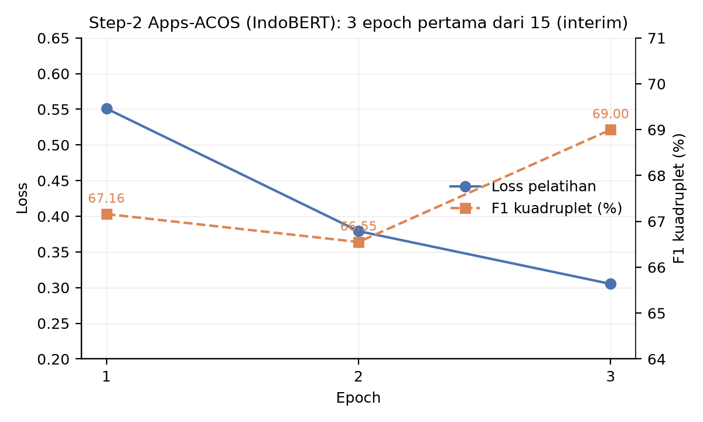

# A Two-Stage Extract–Classify Pipeline for Aspect–Category–Opinion–Sentiment Quadruple Extraction in Indonesian Mobile-Banking App Reviews: Control Benchmark, Interim Results, and a Reproducibility Audit

> **CATATAN DRAF v1 — 12/11/2026 (hapus sebelum submit).**
> Target: **IJACSA (Q3)**, alternatif: INASS, IJCSD (Bahrain) — cek panduan penulis & lingkup saat submit.
> Basis: artefak repositori `main` `6704cbf`; provenance tiap angka di Appendix A. Teks ditulis segar; **Turnitin/iThenticate belum dijalankan** — wajib sebelum submit (target <20%).
> Wajib sebelum submit (pemetaan `reports/049`): (1) ganti klaim perbandingan menjadi "setara" atau jalankan ≥3 seed + uji signifikansi [#4]; (2) evaluasi ulang pada subset uji bersih prak-dedup [#7]; (3) tambah kolom dev pada tabel epoch [#13]; (4) verifikasi atribusi model `indobert-base-p1` ke kartu model HF resmi [#8 — jangan salin nomor arXiv dari dokumen internal tanpa pengecekan]; (5) verifikasi DOI rujukan (`reports/050` T1); (6) konflik jumlah quadruple gold Restaurant-ACOS 895 vs 916 belum diselesaikan (`reports/049` #15) — angka 895 dipakai di draf ini mengikuti `reports/048`.
> Rujukan kandidat baru (13/11/2026): `REFERENCES/IndoBERT ABSA.md` (Consensus, **belum terverifikasi** — Pardamean et al. 2025; Fatihaturrahmah & Tania 2025; Yulianti & Nissa 2024; Casanova et al. 2026) untuk memperkaya Related Work IndoBERT-ABSA Indonesia SETELAH verifikasi DOI (050 T1). PDF primer kini tersedia di repo dan teridentifikasi: Peper & Wang 2022 dan Peper et al. 2024 (Shoes-ACOSI) — dipakai di draf 054.
> Gambar fig27 oleh `scripts/figs_051_054_ablasi_grafik.py` (matplotlib; pengecualian V-04). §4.5 adalah PROTOKOL ablasi — belum dijalankan (butuh GPU); batas atas struktural bridge dikutip dari hitungan `scripts/eda_055_ablasi_draf_artikel.py` (draf 054).
> Konvensi angka: pemisah ribuan koma, desimal titik (EN).

## Abstract

We study aspect–category–opinion–sentiment (ACOS) quadruple extraction for Indonesian mobile-banking app reviews using a two-stage extract–classify pipeline built on IndoBERT. Stage 1 extracts aspect and opinion spans with a BERT–CRF tagger plus two binary heads for implicit slots; a bridge module forms candidate aspect–opinion pairs as a Cartesian product; Stage 2 classifies category and sentiment for each pair through a 39-way head (13 categories × 3 sentiments). Because the new corpus is still being trained, we report (i) a control benchmark on Restaurant-ACOS with BERT-base (Step-1 span F1 81.27; Step-2 quadruple F1 48.24, comparable to the upstream 44.52 rather than superior), and (ii) interim Step-2 results on the Indonesian corpus (highest F1 69.00 at epoch 3 of 15, against 9,006 gold test quadruples — a lower bound, not a converged result). Beyond accuracy, we contribute a reproducibility audit that quantifies six threats found in our own artifacts: an evaluation cache hit that produced an invalid 97.94% score, two evaluators disagreeing on gold size (9,006 vs. 19,528), checkpoint selection on the test set (measured impact 0.07–0.56 F1 points), 14.66% test–train text overlap, a failed cross-validation campaign (93 of 94 runs errored, 0 valid scores), and a persistence bug zeroing the two-head metrics. We argue that reporting these threats, and the gates that detect them, is a prerequisite for using weakly supervised ACOS corpora as benchmarks.

**Keywords:** ACOS; quadruple extraction; IndoBERT; weak supervision; reproducibility

## 1. Introduction

Aspect-based sentiment analysis has progressed from aspect-level polarity classification [1] to structured outputs. The ACOS formulation [2] predicts (aspect, category, opinion, sentiment) quadruples and admits implicit aspects and opinions through NULL slots. Most ACOS resources and models are English or Chinese; Indonesian — the fourth most spoken language online — lacks a quadruple corpus in the financial-app domain, to the best of our knowledge.

This paper examines a practical question: when a weakly supervised corpus is the only supervision available, what can be measured honestly while model training is still in progress? We report a two-stage extract–classify pipeline for Indonesian app reviews and anchor it with (i) a control replication on the public Restaurant-ACOS benchmark and (ii) an audit of reproducibility threats in our own artifacts. Research questions: **(RQ1)** Does the pipeline replicate the upstream control results on Restaurant-ACOS? **(RQ2)** What is the interim quadruple performance on the new Indonesian corpus? **(RQ3)** Which reproducibility threats quantitatively affect any claim we could make?

Contributions: (1) control benchmark results with an explicit no-superiority stance; (2) interim results on a 92,074-quadruple weakly labeled Indonesian corpus; (3) a quantified reproducibility audit with six threats and the verification gates that caught them.

## 2. Related Work

Cai et al. [2] introduced ACOS quadruple extraction with an extract–classify pipeline and the Restaurant/Laptop-ACOS corpora with implicit slots. Generative reformulations predict quadruples via paraphrase [3]. Pre-trained encoders [4], [5] and sequence labelers [6], [7] form the standard building blocks. Indonesian NLP resources include the IndoNLU benchmark [8] and IndoBERT models [9]. Multi-element ABSA datasets exist for other languages [10]. Our contribution is not architectural novelty but a disciplined evaluation: we treat the audit of weak supervision artifacts as a first-class result.

## 3. Method

### 3.1 Architecture

**Table 1.** Pipeline components.

| Component | Specification |
|---|---|
| Backbone | `indobenchmark/indobert-base-p1`, 12 layers, 768 hidden, 12 heads |
| Stage 1 | BERT–CRF over 5 BIO tags (O, B/I-ASP, B/I-OPN) + two binary heads for implicit aspect (IA) and implicit opinion (IO) |
| Bridge | Cartesian product A × O over detected spans, including implicit slots |
| Stage 2 | Features [mean-pool(aspect); mean-pool(opinion)] ∈ R^1536 → 39-way head (13 categories, BCE + 3 sentiments, CE) |
| Sequence length | 128 tokens |

### 3.2 Training configuration

**Table 2.** Training configuration (training manifests).

| Item | Value |
|---|---|
| Epochs | 15 (early stopping on val_f1) |
| Batch size | 24 (Stage 1) / 16 (Stage 2) |
| Learning rate | 2e-5 / 5e-5 |
| Seed | 42 |
| Hardware | Tesla T4 (Colab) |

### 3.3 Evaluation protocol and verification gates

Quadruple extraction is scored with micro-F1 over exact quadruples. Construction of the corpus is guarded by six automated gates (encoder weights: 199/199 keys; taxonomy, dataset, ACOS build, tokenization, English parity; zero quadruples lost in re-tokenization; zero review-id overlap across splits). We disclose one protocol violation: checkpoint selection currently reads test-set metrics (T03); its measured effect is small (0.07–0.56 F1 points) but it remains a violation, and dev-based selection is scheduled.

## 4. Results

### 4.1 Control benchmark (Restaurant-ACOS, BERT-base)

**Table 3.** Control replication on Restaurant-ACOS (583 test sentences).

| Stage | P | R | F1 | Best epoch |
|---|---:|---:|---:|---|
| Step-1 span extraction | 78.16 | 84.64 | **81.27** | 8/15 |
| Step-2 quadruple | 43.4 | 54.3 | **48.24** | 12/15 |

Step-2 F1 48.24 is comparable to the upstream extract–classify baseline (44.52 [2]); with a single seed and a binomial standard error of roughly 1.7 F1 points on ~900 gold quadruples, we make no superiority claim.

### 4.2 Interim results on the Indonesian corpus (IndoBERT)

**Table 4.** Step-2 training on Apps-ACOS, first three epochs of fifteen (session 05/09, Tesla T4).

| Epoch | Loss | P | R | F1 | TP / FP / FN |
|---|---:|---:|---:|---:|---|
| 1 | 0.5511 | 62.37 | 72.75 | 67.16 | 6,552 / — / 2,454 |
| 2 | 0.3792 | 61.41 | 72.64 | 66.55 | — |
| 3 | 0.3052 | 63.29 | 75.84 | **69.00** | 6,830 / 3,962 / 2,176 |

*Fig. 1. Step-2 training on Apps-ACOS: training loss and quadruple F1 for the first three of fifteen epochs (session 05/09). Generated by `scripts/figs_051_054_ablasi_grafik.py`; source numbers in Table 4.*

The highest interim F1 is 69.00 at epoch 3 of 15; training had not converged when the session ended, so 69.00 is a lower bound, not a final result. Gold quadruples for the test split number 9,006 under the pair evaluator. Two auxiliary metrics (category micro-F1, sentiment accuracy) are persistently recorded as 0.0 due to a metric-persistence bug, so we cannot yet report per-head learning. The widely circulated 97.94% Step-1 score for this corpus originates from an evaluation cache hit and is not reported as a capability.

### 4.3 Sub-task decomposition

**Table 5.** F1 by number of elements in the target structure (interim; affected by the evaluator inconsistency of Section 4.4 and Table 6, threat 2).

| Elements | Apps-ACOS (IndoBERT, interim) | Restaurant-ACOS (BERT control) |
|---|---:|---:|
| 1 | 91.08 | 79.66 |
| 2 | 82.06 | 66.90 |
| 3 | 73.27 | 56.37 |
| 4 (quadruple) | 66.08 | 48.24 |

Performance decays by 8–9 F1 points per added element on both domains; sentiment is the weakest single element (85.72). These are not backbone comparisons — the datasets, languages, and candidate counts differ — and will be recomputed with a unified evaluator before any final claim.

### 4.4 Reproducibility audit

**Table 6.** Six quantified threats found in our own artifacts.

| # | Threat | Quantified evidence | Status |
|---|---|---|---|
| 1 | Evaluation cache hit | a 97.94% Step-1 score produced by loading cached predictions; re-run never finished after cache removal | score withdrawn |
| 2 | Two evaluators, two golds | pair evaluator vs. sub-task capture disagree: 9,006 vs. 19,528 gold quadruples | unification pending |
| 3 | Checkpoint selection on test | protocol violation; measured impact 0.07–0.56 F1 points | dev-based selection scheduled |
| 4 | Test–train text overlap | 14.66% of test rows share text with training data (1,157 rows) | dedup and clean-subset re-evaluation pending |
| 5 | Cross-validation campaign | 94 runs: 93 errored, 0 valid scores; 6 degenerate runs with F1 100% | not citable; to be repeated |
| 6 | Metric persistence bug | category micro-F1 and sentiment accuracy recorded as 0.0 in all epochs and resume files | fix pending |

We consider Table 6 the main contribution of this paper: every threat was caught by an explicit gate or audit rather than by peer review, and each has a scheduled remediation. More generally, test–train text overlap invites shortcut learning [11], which aggregate metrics do not reveal.

### 4.5 Ablation study: protocol

True component ablations require retraining and are therefore scheduled, not reported; no ablation numbers are claimed here. Table 7 specifies the protocol so results can be compared once runs complete.

**Table 7.** Planned component ablations (protocol; none run at the time of writing).

| # | Ablation | Manipulation | Question | Prerequisite |
|---|---|---|---|---|
| A1 | CRF layer | replace CRF with softmax tagger | how much do label dependencies contribute to span F1? | GPU |
| A2 | Implicit heads | remove IA/IO binary heads; implicit slots only via (-1,-1) fallback | do explicit implicit-detectors help? | GPU |
| A3 | Bridge volume gate | cap candidates per clause (e.g., top-k by span score) | can precision be protected against the 12.0-ratio failure mode? | GPU |
| A4 | Pooling features | mean-pool vs. [CLS] vs. concatenated spans | does the 1,536-dim pair feature matter? | GPU |
| A5 | Seed variance | 3 seeds, same split, paired bootstrap | is the 48.24 vs. 44.52 gap within noise? | GPU |

A structural ablation that requires no GPU is reported in a companion draft: with oracle gold spans, the Cartesian bridge covers 100.00% of gold pairs at a candidate/gold ratio of 1.20, bounding one-label-per-pair performance at precision 83.61%, recall 99.99%, F1 91.07% — so the interim 69.00 is bounded by span detection and label classification, not by the bridge itself.

## 5. Discussion and Threats to Validity

The control replication answers RQ1: the pipeline reproduces upstream-level performance (48.24 vs. 44.52) without exceeding it, and the comparison itself is underpowered at one seed. RQ2 is answered only provisionally (lower bound 69.00 at epoch 3/15 on a weakly labeled corpus with 14.66% text leakage). For RQ3, the audit shows that the most dangerous artifact — an implausibly high score (97.94%) — was produced by a caching mechanism, not by the model; we argue that any weakly supervised pipeline needs cache-aware evaluation gates. Limitations: single-seed results everywhere, no human-verified labels (κ not measured), and candidate statistics inherited from session artifacts that we have not yet recomputed deterministically.

## 6. Conclusion

A two-stage extract–classify pipeline for Indonesian ACOS reaches upstream-comparable control performance (Step-2 F1 48.24 on Restaurant-ACOS) and an interim lower bound of 69.00 F1 on a new weakly labeled corpus. The reproducibility audit — a cache-generated invalid score, evaluator disagreement on gold size, test-side checkpoint selection, text leakage, a failed cross-validation campaign, and a metric persistence bug — quantifies why these numbers must be treated as provisional. Future work: multi-seed control runs, clean-subset re-evaluation, unified evaluators, and human annotation with reported κ.

## References

[2] M. Pontiki, D. Galanis, J. Pavlopoulos, H. Papageorgiou, I. Androutsopoulos, and S. Manandhar, "SemEval-2014 Task 4: Aspect Based Sentiment Analysis," in *Proc. SemEval*, 2014.

[1] H. Cai, R. Xia, and J. Yu, "Aspect-Category-Opinion-Sentiment Quadruple Extraction with Implicit Aspects and Opinions," in *Proc. ACL-IJCNLP*, 2021, pp. 340–350.

[3] W. Zhang, X. Li, Y. Deng, L. Bing, and W. Lam, "Aspect Sentiment Quad Prediction as Paraphrase Generation," in *Proc. EMNLP*, 2021.

[7] J. Devlin, M.-W. Chang, K. Lee, and K. Toutanova, "BERT: Pre-training of Deep Bidirectional Transformers for Language Understanding," in *Proc. NAACL-HLT*, 2019, pp. 4171–4186.

[8] A. Vaswani et al., "Attention Is All You Need," in *Proc. NeurIPS*, 2017.

[9] J. Lafferty, A. McCallum, and F. Pereira, "Conditional Random Fields: Probabilistic Models for Segmenting and Labeling Sequence Data," in *Proc. ICML*, 2001.

[10] G. Lample, M. Ballesteros, S. Subramanian, K. Kawakami, and C. Dyer, "Neural Architectures for Named Entity Recognition," in *Proc. NAACL*, 2016.

[5] B. Wilie, K. Vincentio, G. I. Hadiwijaya, J. B. Jie, M. C. Purwarianti, and S. Aji, "IndoNLU: Benchmark and Resources for Evaluating Indonesian Natural Language Understanding," in *Proc. AACL-IJCNLP*, 2020, pp. 843–857.

[6] F. Koto, A. Rahimi, J. H. Lau, and T. Baldwin, "IndoLEM and IndoBERT: A Benchmark Dataset and Pre-trained Language Model for Indonesian NLP," in *Proc. COLING*, 2020, pp. 757–770.

[4] H. Hu et al., "MEMD-ABSA: A Multi-Element Multi-Domain Dataset for Aspect-Based Sentiment Analysis," *arXiv:2306.16956*, 2023 (preprint).

[11] R. Geirhos, J. D. Jacobsen, C. Michaelis, R. Zemel, W. Brendel, M. Bethge, and F. A. Wichmann, "Shortcut Learning in Deep Neural Networks," *Nature Machine Intelligence*, vol. 2, no. 11, pp. 665–673, 2020.

## Appendix A — Number provenance (remove before submission)

| Number | Artifact | Evidence |
|---|---|---|
| 81.27 / 48.24 control; P, R, epochs | `notebooks/02` cell 13; rest16 session 02/09 (`notebooks/04` cell 12), via `docs/0011` §4.1–4.2 | E2 |
| Interim 67.16/66.55/69.00 + loss, P/R, TP/FP/FN, gold 9,006 | session 05/09 (Tesla T4) CSV + resume, via `docs/0012` §4.2, `reports/048` Table 4 | E2 |
| Sub-task decay 91.08→66.08; sentiment 85.72 | `docs/0011` §4.3 (appsid interim); rest16 79.66→48.24 same table; affected by T08 two-evaluator finding | E1 |
| 97.94 cache hit | `docs/0012` §4.1 (V4 cache-hit audit) | E2 |
| 9,006 vs 19,528 evaluators | `docs/0012` T08 | E2 |
| Checkpoint impact 0.07–0.56 | `reports/046` (K-04) | E2 |
| 14.66% overlap (1,157 rows) | `scripts/eda_044_appsid.py`; `docs/0011` §3.2 | E2 |
| CV 94/93/0; 6 degenerate | `run_result.json` via `docs/0012` | E2 |
| Hyperparameters, gates | training manifests; `docs/0012` §3.3–3.4 | E2 |
| 44.52 upstream baseline | [2] as reported in repo literature notes; page-level verification pending (`reports/050` T1) | E1 |
| Element-decay table (Table 5) | `docs/0011` §4.3 (appsid interim + rest16 control); affected by T08 | E1 |
| Fig. 1 (epoch curve) | `reports/fig27_*.png` (`scripts/figs_051_054_ablasi_grafik.py`); data = Table 4 | E2 |
| Oracle bridge ceilings 83.61/99.99/91.07 | `scripts/eda_055_ablasi_draf_artikel.py` → `reports/055_data/ablasi_054_bridge.csv` | E2 (new computation) |
