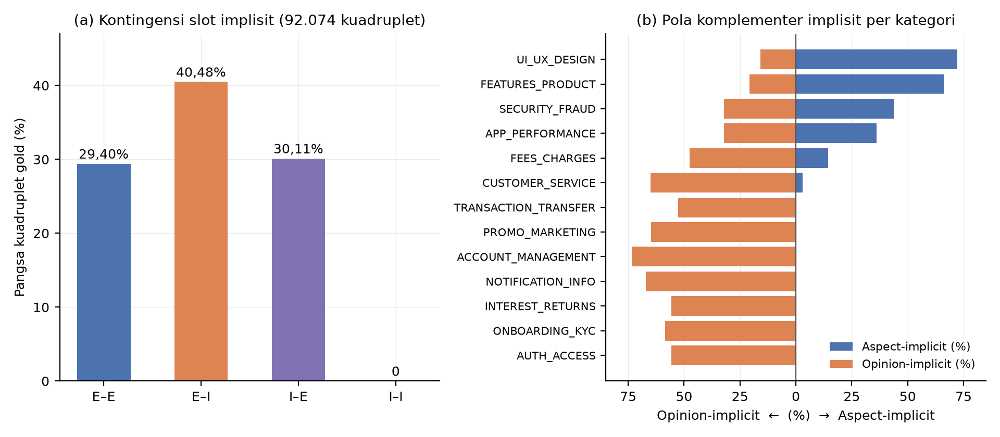

# One Slot Implicit, Never Both: The Structure of Implicit Aspect and Opinion Slots in a Weakly Labeled Indonesian ACOS Corpus, and Its Consequences for Candidate Bridging

> **CATATAN DRAF v1 — 12/11/2026 (hapus sebelum submit).**
> Target: **IJCSD — International Journal of Computing and Digital Systems, Bahrain (Q3)**, alternatif: INASS, IJACSA — cek panduan penulis & lingkup saat submit.
> Basis: artefak repositori `main` `6704cbf`. Angka gold dihitung oleh `scripts/eda_053_majority_baseline_implisit.py` (stdlib, deterministik, 12/11/2026; keluaran `reports/053_data/implisit_2x2_kategori.csv`). Angka kandidat berasal dari artefak sesi (analisis `reports/041`–`042`) dan **belum dihitung ulang deterministik**; anomali label domain pada sesi sumber terdokumentasi. Teks ditulis segar; **Turnitin/iThenticate belum dijalankan** — wajib sebelum submit.
> Wajib sebelum submit: (1) hitung ulang distribusi kandidat dari artefak prediksi secara deterministik; (2) anotasi manusia + κ — status "implisit" adalah keputusan pelabelan lemah [`reports/049` #2]; (3) verifikasi DOI rujukan (`reports/050` T1); (4) angka gold Restaurant-ACOS 895 di Tabel 4 masih konflik dengan 916 (`reports/033`; `reports/049` #15).
> Gambar fig29 oleh `scripts/figs_051_054_ablasi_grafik.py` (matplotlib; pengecualian V-04); ablasi struktural §4.5 oleh `scripts/eda_055_ablasi_draf_artikel.py` (stdlib) → `reports/055_data/ablasi_054_bridge.csv`.
> Konvensi angka: pemisah ribuan koma, desimal titik (EN).

## Abstract

The ACOS formulation of aspect-based sentiment analysis admits implicit aspects and opinions through NULL slots, yet the empirical structure of implicitness at the quadruple level is rarely reported. We analyze a weakly labeled Indonesian corpus of 92,074 quadruples from mobile-banking app reviews and find a strict structural property: implicitness never co-occurs. Exactly one slot is implicit in 70.59% of quadruples (opinion-implicit 40.48%, aspect-implicit 30.11%), both slots are explicit in 29.40%, and both implicit in 0.00% — the labeling schema cannot express double-implicit quadruples at all. Implicitness also varies sharply by category: aspect-implicit ranges from 0% (authentication, onboarding) to 72.27% (interface design), while opinion-implicit ranges from 15.86% (interface design) to 73.36% (account management), in a complementary pattern. On the modeling side, the candidate bridge that pairs predicted aspects with opinions generates 10,735 candidates against 9,006 gold quadruples (ratio 1.19), of which only 7 (0.07%) are implicit–implicit — all necessarily false positives given the gold structure. With oracle gold spans, the Cartesian bridge covers 100.00% of gold pairs at a candidate/gold ratio of 1.20, bounding one-label-per-pair performance at precision 83.61%, recall 99.99%, and F1 91.07% — a structural ceiling against which the interim 69.00 leaves a 22.07-point gap attributable to span detection and label classification rather than the bridge. We further document a cross-domain failure in which unbounded candidate generation under stale predictions produced 10,735 candidates against 895 gold quadruples (ratio 12.0) and collapsed quadruple F1 to 0.00. We conclude that implicit-slot reporting should be stratified, schema-level constraints on implicitness must be documented, and candidate bridges need explicit volume control.

**Keywords:** ACOS; implicit aspects; implicit opinions; weak supervision; candidate generation; Indonesian

## 1. Introduction

Aspect–category–opinion–sentiment (ACOS) quadruple extraction [1] extended aspect-based sentiment analysis by allowing aspect and opinion slots to be implicit, encoded as NULL. Implicit slots are not an edge case: in English ACOS corpora a substantial share of quadruples carry them [1], and any serious evaluation must therefore ask how models behave on implicit material. What is usually not reported is the joint structure of implicitness: how often aspect and opinion are implicit together, and how implicitness distributes across categories.

We study this question on a weakly labeled Indonesian corpus of 92,074 quadruples built from mobile-banking app reviews, in the context of a two-stage extract–classify pipeline whose bridge module forms candidate aspect–opinion pairs. Our contributions: (1) a quadruple-level contingency analysis showing that implicitness is exclusive — never both slots at once (0 of 92,074) — which is a schema property with direct consequences for what "supports implicit slots" can mean; (2) a per-category breakdown showing a complementary pattern (categories where users name the aspect but not the opinion, versus the reverse); (3) an analysis of candidate-side behaviour showing that the bridge mirrors the gold structure (implicit–implicit candidates are 0.07% and provably false positives), plus a documented cross-domain case where unbounded candidate generation collapsed F1 to zero.

Research questions: **(RQ1)** What is the joint distribution of aspect/opinion implicitness in the gold data? **(RQ2)** How does implicitness vary across categories? **(RQ3)** Does the candidate bridge reproduce or distort this structure, and with what consequences?

## 2. Related Work

Aspect-based sentiment analysis originated with SemEval aspect-level tasks [2] and evolved toward structured outputs. ACOS [1] unified aspect, category, opinion, and sentiment prediction with NULL slots for implicit aspects and opinions. Generative approaches reformulated quadruple prediction as paraphrase generation [3]. Surveys document that implicit material remains among the hardest phenomena and is often under-reported in evaluations [4]. For Indonesian, benchmark resources exist for sentence- and aspect-level tasks [5], but no quadruple-level corpus with implicit slots was available, to the best of our knowledge. Our pipeline uses a BERT-family encoder [6] with a CRF tagger [7]. We add to this line a measurement study: we treat the joint structure of implicitness, and its interaction with candidate generation, as first-class findings.

## 3. Data and Method

### 3.1 Corpus

The corpus (built by the authors, weakly labeled, no human verification yet; κ not measured) contains 92,074 quadruples over 76,077 clauses from 43,673 reviews of 13 Indonesian mobile-banking apps: train 72,973, dev 9,587, test 9,514 quadruples; 13 categories; 3 sentiment classes. Each quadruple carries token-index spans for aspect and opinion with exclusive end bounds; implicit slots are encoded as (-1,-1) following [1]. Per-split implicitness is stable (aspect 29.86–31.28%, opinion 39.13–40.70%).

### 3.2 Analysis

Gold-side statistics are computed with a deterministic standard-library script over the released TSVs: a 2×2 contingency of (aspect implicit?) × (opinion implicit?) and per-category implicit shares. Candidate-side statistics come from a Stage-1 prediction artifact (10,735 candidate pairs against 9,006 gold test quadruples) recorded in session artifacts; we report them with the caveat that a domain-label anomaly in the source session is documented and a deterministic recomputation is scheduled. All numbers and their provenance are listed in Appendix A.

## 4. Results

### 4.1 Implicitness is exclusive (RQ1)

**Table 1.** Joint distribution of slot implicitness in gold quadruples (92,074).

| Aspect \ Opinion | Explicit | Implicit |
|---|---:|---:|
| Explicit | 27,074 (29.40%) | 37,274 (40.48%) |
| Implicit | 27,726 (30.11%) | **0 (0.00%)** |

*Fig. 1. (a) Joint distribution of slot implicitness: the implicit–implicit cell is exactly zero. (b) Complementary implicitness pattern across the 13 categories (diverging bars). Generated by `scripts/figs_051_054_ablasi_grafik.py` from `reports/053_data/implisit_2x2_kategori.csv`.*

Exactly one slot is implicit in 70.59% of quadruples; both are explicit in 29.40%; both are implicit in none. The marginals reproduce the per-split statistics (aspect-implicit 30.11%, opinion-implicit 40.48%), and the zero cell is exact: the labeling schema never emits a quadruple with two implicit slots. Any statement that a corpus or model "handles implicit aspects and opinions" must therefore be qualified: in this corpus, implicitness is single-slot by construction, and double-implicit sentiment (a clause-level opinion with neither span) is inexpressible.

### 4.2 Implicitness varies by category, complementarily (RQ2)

**Table 2.** Implicit shares per category (gold, all splits pooled).

| Category | Quadruples | Aspect-implicit | Opinion-implicit |
|---|---:|---:|---:|
| FEATURES_PRODUCT | 27,694 | 66.16% | 20.83% |
| TRANSACTION_TRANSFER | 14,752 | 0.30% | 52.60% |
| APP_PERFORMANCE | 9,718 | 36.03% | 32.06% |
| AUTH_ACCESS | 6,615 | 0.00% | 55.71% |
| ONBOARDING_KYC | 6,585 | 0.00% | 58.60% |
| UI_UX_DESIGN | 6,225 | 72.27% | 15.86% |
| CUSTOMER_SERVICE | 4,845 | 2.99% | 65.12% |
| INTEREST_RETURNS | 3,749 | 0.00% | 55.61% |
| NOTIFICATION_INFO | 3,414 | 0.00% | 67.16% |
| FEES_CHARGES | 2,881 | 14.47% | 47.52% |
| ACCOUNT_MANAGEMENT | 1,952 | 0.00% | 73.36% |
| PROMO_MARKETING | 1,822 | 0.00% | 64.71% |
| SECURITY_FRAUD | 1,822 | 43.74% | 32.11% |
| **Total** | **92,074** | **30.11%** | **40.48%** |

Two regimes are visible. In service- and flow-oriented categories (account management 73.36% opinion-implicit; notification 67.16%; customer service 65.12%), users name the aspect ("saldo", "notif") and leave the opinion implicit — the complaint is the failure itself. In evaluation-oriented categories (interface design 72.27% aspect-implicit, 15.86% opinion-implicit; features 66.16% / 20.83%), users voice the opinion ("bagus", "membingungkan") and leave the aspect implicit. Seven categories have exactly 0.00% aspect-implicit quadruples.

### 4.3 The bridge mirrors — and slightly violates — the structure (RQ3)

**Table 3.** Candidate pairs from Stage-1 predictions vs. gold structure.

| Pair type | Candidates | Share | Gold counterpart |
|---|---:|---:|---|
| Explicit–Implicit | 4,459 | 41.54% | 40.48% |
| Explicit–Explicit | 3,456 | 32.19% | 29.40% |
| Implicit–Explicit | 2,813 | 26.20% | 30.11% |
| Implicit–Implicit | 7 | 0.07% | **0.00%** |
| **Total** | **10,735** | 100% | 9,006 gold (ratio 1.19) |

The candidate distribution tracks the gold marginals closely, but the bridge does emit 7 implicit–implicit candidates — formed when both implicit heads fire — and since the gold contains no double-implicit quadruple, all 7 are false positives by construction. In other words: on this corpus the bridge's known inability to form double-implicit pairs costs no recall; the 7 it does form cost precision. More consequential is volume: at ratio 1.19 the bridge is well-behaved, but the ratio is not bounded by design, which the next case shows.

### 4.4 A cross-domain volume failure

**Table 4.** Candidate volume and outcome across configurations.

| Configuration | Candidates | Gold | Ratio | Outcome |
|---|---:|---:|---:|---|
| Apps-ACOS (in-domain) | 10,735 | 9,006 | 1.19 | interim Step-2 F1 up to 69.00 (epoch 3/15) |
| Restaurant-ACOS (proper Stage-1) | ~1,450 | 895 | ~1.6 | Step-2 F1 48.24 |
| Restaurant-ACOS (stale predictions) | 10,735 | 895 | 12.0 | 165,728 FP; Step-2 F1 0.00 |

In one documented session, Stage-1 predictions inherited from another domain/session were bridged for Restaurant-ACOS, producing 12 candidates per gold quadruple; false positives exploded and quadruple F1 collapsed to 0.00. This is not a model failure but a candidate-generation failure — the bridge has no volume control, and its behaviour is determined by whatever Stage-1 feeds it.

### 4.5 Structural ablation of the bridge

Two structural ablations are computed directly from the released gold TSVs (deterministic script `scripts/eda_055_ablasi_draf_artikel.py`; outputs in `reports/055_data/ablasi_054_bridge.csv`). They require no model and no GPU.

**Table 5.** Oracle bridge on the test split: gold spans per clause are fed to the Cartesian pairing.

| Measure | Value |
|---|---:|
| Test clauses | 7,891 |
| Gold quadruples | 9,514 |
| Unique (aspect, opinion) pairs | 9,513 |
| Oracle Cartesian candidates | 11,378 |
| Candidate/gold ratio | 1.20 |
| Gold-pair coverage by Cartesian product | 100.00% |
| Pairs carrying >1 distinct sentiment | 1 (2 quadruples) |
| Pairs carrying >1 distinct category | 0 |

A methodological note: the gold total here (9,514, read from the released TSV) differs from the pair-evaluator total (9,006) used for the session artifacts of Table 3 — the evaluator inconsistency documented in our reproducibility audit; the TSV is used as ground truth for this computation.

**Table 6.** Ceilings implied by Table 5, and candidate suppression.

| Quantity | Value |
|---|---:|
| Precision ceiling (one label per pair) | 9,513 / 11,378 = 83.61% |
| Recall ceiling (one label per pair) | 9,513 / 9,514 = 99.99% |
| F1 ceiling | 91.07% |
| Interim Step-2 F1 (predicted spans, epoch 3/15) | 69.00 |
| Gap to structural ceiling | 22.07 points |
| Suppressing implicit–implicit candidates | 10,735 → 10,728 (−7; all provably false positives) |

Three conclusions follow. First, the (aspect, opinion) → label mapping is essentially functional: exactly one pair in 9,513 carries two different sentiments, so the single-label-per-pair assumption of the classifier head costs at most 0.01% recall on this corpus. Second, the bridge itself is not the bottleneck: with oracle spans its volume is benign (ratio 1.20) and its coverage complete, so the 22.07-point gap between the interim 69.00 and the 91.07 ceiling is attributable to Step-1 span detection and Step-2 classification. Third, the cross-domain collapse of Section 4.4 is a volume effect of stale predictions, not a property of the Cartesian construction — which motivates a volume gate rather than a redesign of the bridge.

## 5. Discussion

**(RQ1)** Implicitness in this corpus is structurally single-slot. This reframes a common claim: "including implicit slots" here means 70.59% single-implicit quadruples and a schema-level impossibility of double-implicit ones. Schema constraints of this kind belong in corpus documentation, otherwise cross-corpus comparisons of implicit handling are meaningless. **(RQ2)** The complementary per-category pattern suggests category-conditioned strategies (e.g., opinion lexicons for flow categories, aspect lexicons for evaluation categories) and warns that aggregate implicit metrics hide a 0–73% range. **(RQ3)** The bridge inherits the gold structure almost exactly, but its unbounded Cartesian construction is fragile under domain shift; a volume gate (candidates per gold, or per sentence) is a cheap safeguard, and implicit–implicit suppression would remove a provably-false candidate class on this corpus.

Limitations: (i) labels are weakly supervised and unverified — implicitness is partly a labeling decision, so the 0.00% cell reflects the schema, not necessarily the language; (ii) candidate statistics derive from session artifacts with a documented domain-label anomaly and await deterministic recomputation; (iii) single domain, single language. The interim F1 69.00 cited in Table 4 is a lower bound from epoch 3 of 15 on a corpus with 14.66% test–train text overlap.

## 6. Conclusion

In a 92,074-quadruple Indonesian ACOS corpus, implicitness is exclusive: one slot implicit in 70.59% of quadruples, both explicit in 29.40%, both implicit in 0.00% — a schema property that must accompany any claim of implicit-slot support. Implicitness varies complementarily across categories (aspect-implicit 0–72.27%; opinion-implicit 15.86–73.36%). The candidate bridge mirrors this structure (implicit–implicit candidates 0.07%, all false positives by construction) but lacks volume control, as a documented cross-domain collapse to F1 0.00 shows. With oracle spans the bridge covers all gold pairs and bounds one-label-per-pair F1 at 91.07%, so the remaining 22.07-point gap to the interim 69.00 lies in span detection and classification. Future work: deterministic recomputation of candidate statistics, human verification with κ, implicit-stratified evaluation reporting, and a labeling schema that can express double-implicit opinions.

## References

[1] H. Cai, R. Xia, and J. Yu, "Aspect-Category-Opinion-Sentiment Quadruple Extraction with Implicit Aspects and Opinions," in *Proc. ACL-IJCNLP*, 2021, pp. 340–350.

[2] M. Pontiki, D. Galanis, J. Pavlopoulos, H. Papageorgiou, I. Androutsopoulos, and S. Manandhar, "SemEval-2014 Task 4: Aspect Based Sentiment Analysis," in *Proc. SemEval*, 2014.

[3] W. Zhang, X. Li, Y. Deng, L. Bing, and W. Lam, "Aspect Sentiment Quad Prediction as Paraphrase Generation," in *Proc. EMNLP*, 2021.

[4] W. Zhang, X. Li, Y. Deng, L. Bing, and W. Lam, "A Survey on Aspect-Based Sentiment Analysis: Tasks, Methods, and Challenges," *IEEE Trans. Knowl. Data Eng.*, 2022.

[5] B. Wilie, K. Vincentio, G. I. Hadiwijaya, J. B. Jie, M. C. Purwarianti, and S. Aji, "IndoNLU: Benchmark and Resources for Evaluating Indonesian Natural Language Understanding," in *Proc. AACL-IJCNLP*, 2020, pp. 843–857.

[6] J. Devlin, M.-W. Chang, K. Lee, and K. Toutanova, "BERT: Pre-training of Deep Bidirectional Transformers for Language Understanding," in *Proc. NAACL-HLT*, 2019, pp. 4171–4186.

[7] J. Lafferty, A. McCallum, and F. Pereira, "Conditional Random Fields: Probabilistic Models for Segmenting and Labeling Sequence Data," in *Proc. ICML*, 2001.

## Appendix A — Number provenance (remove before submission)

| Number | Artifact | Evidence |
|---|---|---|
| 2×2 contingency (Table 1); per-split implicitness | `scripts/eda_053_majority_baseline_implisit.py` → `reports/053_data/implisit_2x2_kategori.csv` (12/11/2026) | E2 (new computation) |
| Per-category implicit shares (Table 2) | same script/CSV; cross-checked against `reports/044_data/split_stats.csv` marginals | E2 |
| Corpus sizes 92,074 / 72,973 / 9,587 / 9,514 / 43,673 / 13 apps | `reports/044_data/eda_summary.json` (`scripts/eda_044_appsid.py`) | E2 |
| Candidates 10,735; type distribution; gold 9,006 | session artifact `master_04_type_pasangan.csv` analyzed in `reports/042` (domain-label anomaly documented there) | E2 (session artifact; recomputation pending) |
| Cross-domain case: ~1,450 vs 895; 10,735 vs 895; 165,728 FP; F1 0.00 | `reports/041` C07 and §"kegagalan pembentukan pasangan"; `reports/042` session analysis | E2 (session artifacts) |
| Interim F1 69.00 (epoch 3/15); Step-2 control 48.24 | `docs/0011` §4.1–4.2; `docs/0012` §4.2; `reports/048` Table 4 | E2 (via 0011/0012/048) |
| 14.66% test–train overlap | `scripts/eda_044_appsid.py`; `docs/0011` §3.2 | E2 |
| "implicit share is substantial in English corpora" [1] | literature notes in `ACOS-IndoBERT/REFERENCES/`; page-level verification pending (`reports/050` T1) | E1 |
| Tables 5–6 (oracle bridge, ceilings, suppression) | `scripts/eda_055_ablasi_draf_artikel.py` (12/11/2026) → `reports/055_data/ablasi_054_bridge.csv` | E2 (new computation) |
| Fig. 1 | `reports/fig29_*.png` (`scripts/figs_051_054_ablasi_grafik.py`) | E2 |
